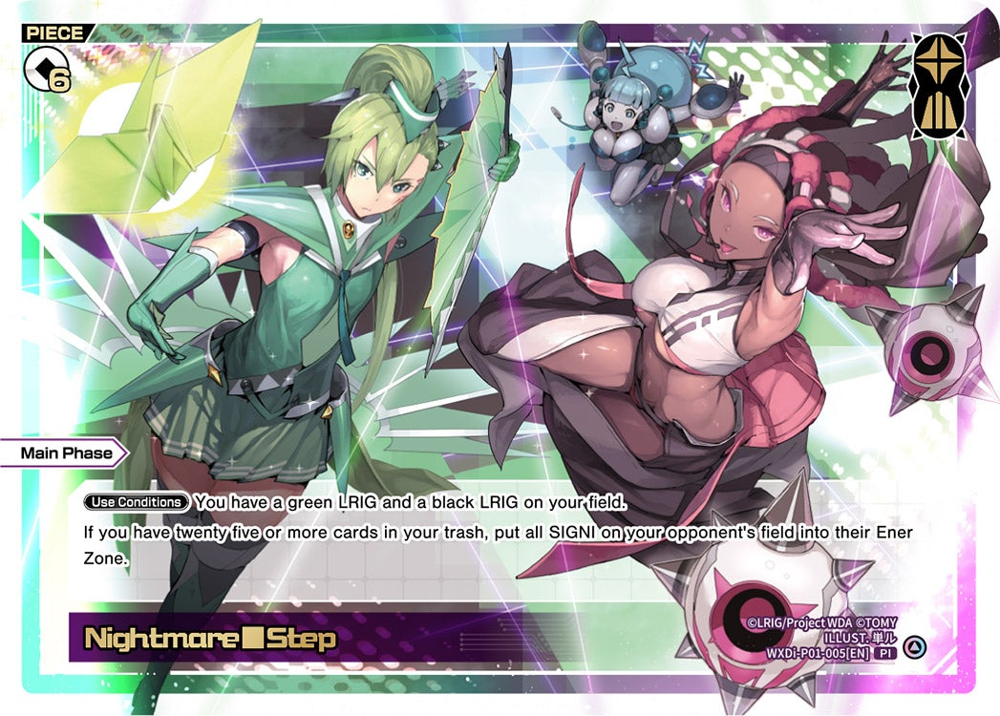

# Nightmare■Step

## Thông tin lá

| Trường | Giá trị |
| --- | --- |
| Mã in | WXDi-P01-005[EN] |
| Set | WXDi-P01[EN] |
| Số thứ tự | 005 |
| Loại thẻ | PIECE |
| Vị trí | LRIG Deck |
| Số bản | — (set booster, không áp dụng) |
| Màu | Đen / xanh lá |
| Độ hiếm | PI |
| Minh họa | 単ル |
| Level | — |
| Limit | — |
| Power | 0 |
| LRIG type / Class | — |
| Team / Master | — |
| Cost | 《C》×６ |
| Grow cost | — |
| Use timing | Main Phase |
| Life Burst | Không |

## Card text chính thức

[Use Conditions] You have a green LRIG and a black LRIG on your field.

If you have twenty five or more cards in your trash, put all SIGNI on your opponent's field into their Ener Zone.

## Power text / Life Burst

—

## Ghi chú minh họa
Artist: 単ル. Ảnh PI được tải từ Card List tiếng Anh.

## FAQ chính thức

**Q. If a SIGNI placed into the Ener Zone by this card has an [Auto] that triggered when vanished, will that ability triggered?**
A. No, it will not trigger. The effect of this card, put ~ into their Ener Zone. is distinct from vanish.

**Q. Will the SIGNI in my opponent's hand or the SIGNI turned face down in the SIGNI Zone be placed in the Ener Zone?**
A. No, only the SIGNI in the SIGNI zone is put into the "Ener zone" by this effect. And the cards placed face down in the SIGNI zone are not treated as SIGNI, so they remain in the field.

## Nguồn
[Card List/FAQ chính thức](https://www.takaratomy.co.jp/products/en.wixoss/card/card.html?card_no=WXDi-P01-005%5BEN%5D ) · [Ảnh thẻ](https://www.takaratomy.co.jp/products/en.wixoss/card/thumb/WXDi-P01-005%5BEN%5D.jpg)
