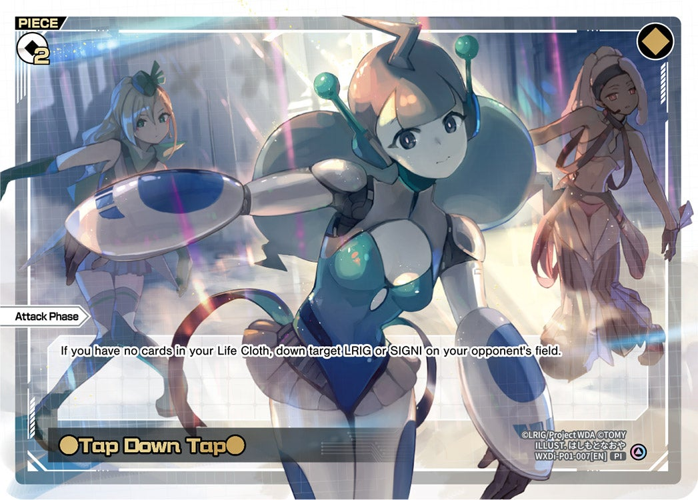

# ●Tap Down Tap●

## Thông tin lá

| Trường | Giá trị |
| --- | --- |
| Mã in | WXDi-P01-007[EN] |
| Set | WXDi-P01[EN] |
| Số thứ tự | 007 |
| Loại thẻ | PIECE |
| Vị trí | LRIG Deck |
| Số bản | — (set booster, không áp dụng) |
| Màu | Không màu |
| Độ hiếm | PI |
| Minh họa | はしもとなおや |
| Level | — |
| Limit | — |
| Power | 0 |
| LRIG type / Class | — |
| Team / Master | — |
| Cost | 《C》×２ |
| Grow cost | — |
| Use timing | Attack Phase |
| Life Burst | Không |

## Card text chính thức

If you have no cards in your Life Cloth, down target LRIG or SIGNI on your opponent's field.

## Power text / Life Burst

—

## Ghi chú minh họa
Artist: はしもとなおや. Ảnh PI được tải từ Card List tiếng Anh.

## FAQ chính thức

— (không có FAQ riêng cho mã này trên trang FAQ tiếng Anh.)

## Nguồn
[Card List/FAQ chính thức](https://www.takaratomy.co.jp/products/en.wixoss/card/card.html?card_no=WXDi-P01-007%5BEN%5D ) · [Ảnh thẻ](https://www.takaratomy.co.jp/products/en.wixoss/card/thumb/WXDi-P01-007%5BEN%5D.jpg)
