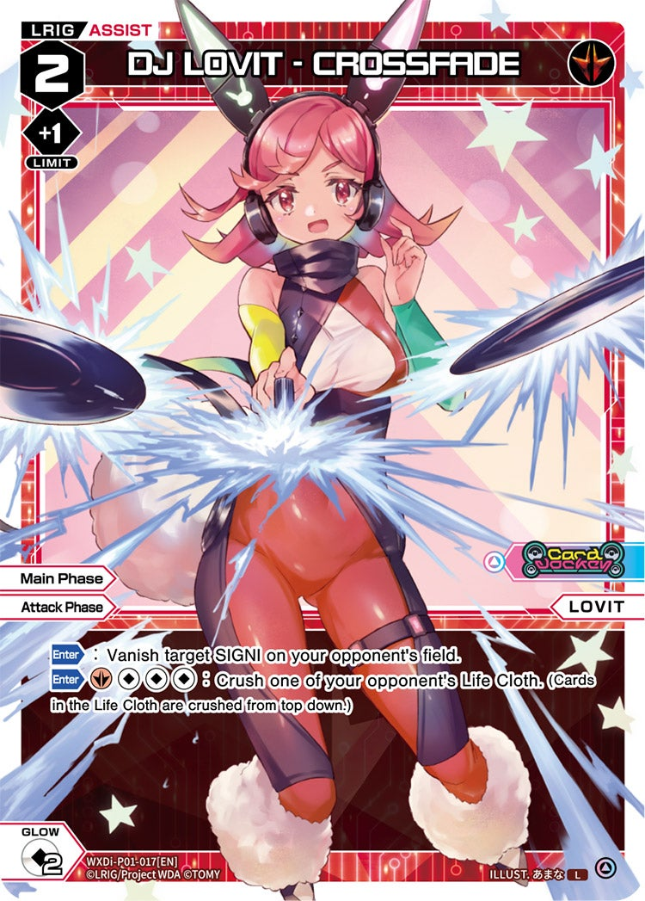

# DJ LOVIT - CROSSFADE

## Thông tin lá

| Trường | Giá trị |
| --- | --- |
| Mã in | WXDi-P01-017[EN] |
| Set | WXDi-P01[EN] |
| Số thứ tự | 017 |
| Loại thẻ | ASSIST LRIG |
| Vị trí | LRIG Deck |
| Số bản | — (set booster, không áp dụng) |
| Màu | Đỏ |
| Độ hiếm | L,L(P) |
| Minh họa | あまな |
| Level | 2 |
| Limit | ＋１ |
| Power | 0 |
| LRIG type / Class | LOVIT |
| Team / Master | Card Jockey |
| Cost | — |
| Grow cost | 《C》×２ |
| Use timing | Main Phase
Attack Phase |
| Life Burst | Không |

## Card text chính thức

[Enter]: Vanish target SIGNI on your opponent's field.
[Enter] {Red} {Colorless} {Colorless} {Colorless}: Crush one of your opponent's Life Cloth. (Cards in the Life Cloth are crushed from top down.)

## Power text / Life Burst

—

## Ghi chú minh họa
Artist: あまな. Ảnh L được tải từ Card List tiếng Anh.

## FAQ chính thức

**Q. Can I activate Life cloth's Life Burst that was crashed by [Enter]?**
A. Yes, you can. The procedure when crashed is the same as when crashed by an attack.

## Ảnh biến thể

- [L(P)](../images/WXDi-P01-017P-EN.jpg)

## Nguồn
[Card List/FAQ chính thức](https://www.takaratomy.co.jp/products/en.wixoss/card/card.html?card_no=WXDi-P01-017%5BEN%5D ) · [Ảnh thẻ](https://www.takaratomy.co.jp/products/en.wixoss/card/thumb/WXDi-P01-017%5BEN%5D.jpg)
