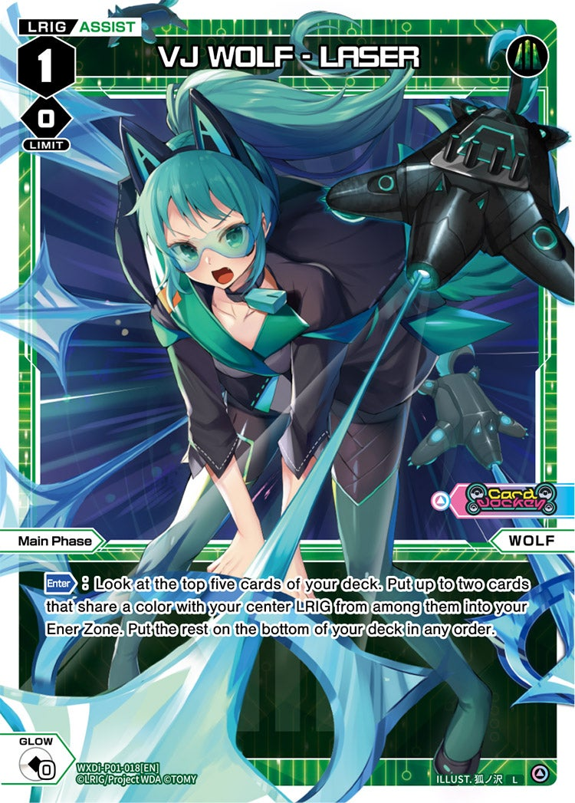

# VJ WOLF - LASER

## Thông tin lá

| Trường | Giá trị |
| --- | --- |
| Mã in | WXDi-P01-018[EN] |
| Set | WXDi-P01[EN] |
| Số thứ tự | 018 |
| Loại thẻ | ASSIST LRIG |
| Vị trí | LRIG Deck |
| Số bản | — (set booster, không áp dụng) |
| Màu | Xanh lá |
| Độ hiếm | L,L(P) |
| Minh họa | 狐ノ沢 |
| Level | 1 |
| Limit | 0 |
| Power | 0 |
| LRIG type / Class | WOLF |
| Team / Master | Card Jockey |
| Cost | — |
| Grow cost | 《C》×０ |
| Use timing | Main Phase |
| Life Burst | Không |

## Card text chính thức

[Enter]: Look at the top five cards of your deck. Put up to two cards that share a color with your center LRIG from among them into your Ener Zone. Put the rest on the bottom of your deck in any order.

## Power text / Life Burst

—

## Ghi chú minh họa
Artist: 狐ノ沢. Ảnh L được tải từ Card List tiếng Anh.

## FAQ chính thức

**Q. Can I put a SIGNI with more than one color, such as 《Bronze, Natural Crystal》, on the Ener zone?**
A. Yes, if one of those two colors is common to the center LRIG, it can be placed in the Ener zone.

**Q. Can 《Servant #》 with [Multi Ener] be placed in the Ener Zone with this effect?**
A. No, you cannot place it. [Multi Ener] is an ability that allows you to pay the Ener Cost as one color of your choice, but it does not change the color of the card itself. Since 《Servant #》 is colorless, it has no color in common with the center LRIG.

## Ảnh biến thể

- [L(P)](../images/WXDi-P01-018P-EN.jpg)

## Nguồn
[Card List/FAQ chính thức](https://www.takaratomy.co.jp/products/en.wixoss/card/card.html?card_no=WXDi-P01-018%5BEN%5D ) · [Ảnh thẻ](https://www.takaratomy.co.jp/products/en.wixoss/card/thumb/WXDi-P01-018%5BEN%5D.jpg)
