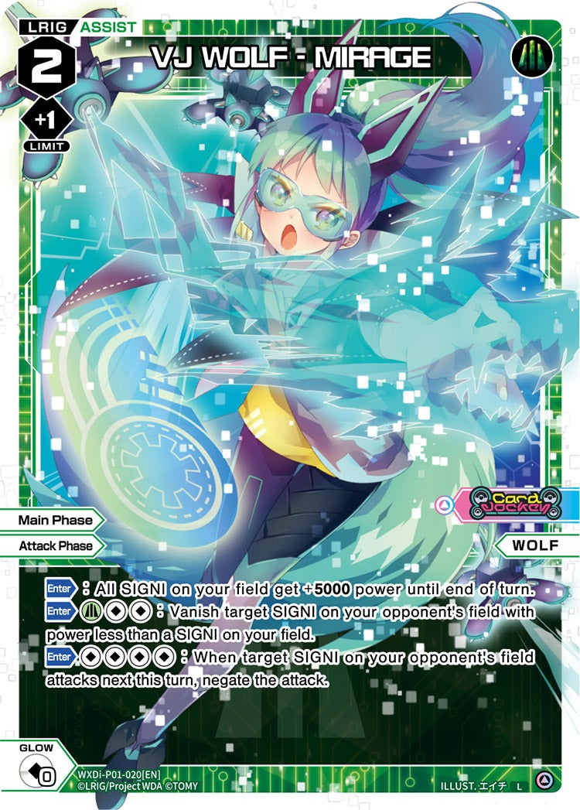

# VJ WOLF - MIRAGE

## Thông tin lá

| Trường | Giá trị |
| --- | --- |
| Mã in | WXDi-P01-020[EN] |
| Set | WXDi-P01[EN] |
| Số thứ tự | 020 |
| Loại thẻ | ASSIST LRIG |
| Vị trí | LRIG Deck |
| Số bản | — (set booster, không áp dụng) |
| Màu | Xanh lá |
| Độ hiếm | L,L(P) |
| Minh họa | エイチ |
| Level | 2 |
| Limit | ＋１ |
| Power | 0 |
| LRIG type / Class | WOLF |
| Team / Master | Card Jockey |
| Cost | — |
| Grow cost | 《C》×０ |
| Use timing | Main Phase
Attack Phase |
| Life Burst | Không |

## Card text chính thức

[Enter]: All SIGNI on your field get +5000 power until end of turn.
[Enter] {Green} {Colorless} {Colorless}: Vanish target SIGNI on your opponent's field with power less than a SIGNI on your field.
[Enter] {Colorless} {Colorless} {Colorless} {Colorless}: When target SIGNI on your opponent's field attacks next this turn, negate the attack.

## Power text / Life Burst

—

## Ghi chú minh họa
Artist: エイチ. Ảnh L được tải từ Card List tiếng Anh.

## FAQ chính thức

**Q. After activating the first [Enter] and gaining +5000 power, can I target an opponent's SIGNI with less power than the SIGNI that was +5000 by the second [Enter]?**
A. Yes, you can. If you have multiple trigger abilities, you can activate them in any order you want. Also, since you pay the cost when you activate it and then choose the target, you can target an opponent's SIGNI with low power, give it +5000, and then vanish it, if you use the order in question.

**Q. I targeted a SIGNI with [Auto] that triggers "when attacked" by my opponent with [Enter] at the bottom. Will [Auto] be triggered when that SIGNI attacks?**
A. Yes, it will be triggered. When the "negate" effect is processed on SIGNI or LRIG, they are no longer "attacking". Therefore, they will not battle the SIGNI in front of them. They also do not deal any damage to the opponent. However, the record that the SIGNI or LRIG's attack are kept, so the effects triggered by the attack will still be triggered.

**Q. I targeted an opponent's SIGNI with [Double Crush] with [Enter] at the bottom. If that SIGNI attacks, how many Life Cloths will be crushed?**
A. Not even one card is crushed. [Double Crush] is not attacking twice, it is attacking once and crushing two cards when it deals damage. That one attack is negated by this ability.

## Ảnh biến thể

- [L(P)](../images/WXDi-P01-020P-EN.jpg)

## Nguồn
[Card List/FAQ chính thức](https://www.takaratomy.co.jp/products/en.wixoss/card/card.html?card_no=WXDi-P01-020%5BEN%5D ) · [Ảnh thẻ](https://www.takaratomy.co.jp/products/en.wixoss/card/thumb/WXDi-P01-020%5BEN%5D.jpg)
