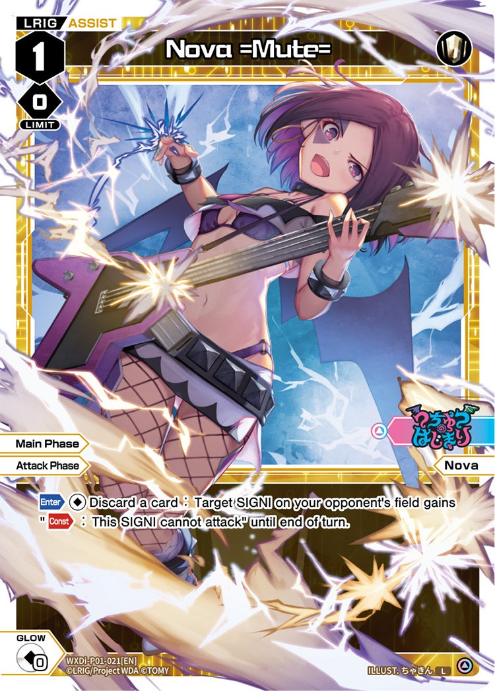

# Nova =Mute=

## Thông tin lá

| Trường | Giá trị |
| --- | --- |
| Mã in | WXDi-P01-021[EN] |
| Set | WXDi-P01[EN] |
| Số thứ tự | 021 |
| Loại thẻ | ASSIST LRIG |
| Vị trí | LRIG Deck |
| Số bản | — (set booster, không áp dụng) |
| Màu | Trắng |
| Độ hiếm | L,L(P) |
| Minh họa | ちゃきん |
| Level | 1 |
| Limit | 0 |
| Power | 0 |
| LRIG type / Class | Nova |
| Team / Master | UCHU NO HAJIMARI |
| Cost | — |
| Grow cost | 《C》×０ |
| Use timing | Main Phase
Attack Phase |
| Life Burst | Không |

## Card text chính thức

[Enter] {Colorless} Discard a card: Target SIGNI on your opponent's field gains "[Constant]: This SIGNI cannot attack" until end of turn.

## Power text / Life Burst

—

## Ghi chú minh họa
Artist: ちゃきん. Ảnh L được tải từ Card List tiếng Anh.

## FAQ chính thức

— (không có FAQ riêng cho mã này trên trang FAQ tiếng Anh.)

## Ảnh biến thể

- [L(P)](../images/WXDi-P01-021P-EN.jpg)

## Nguồn
[Card List/FAQ chính thức](https://www.takaratomy.co.jp/products/en.wixoss/card/card.html?card_no=WXDi-P01-021%5BEN%5D ) · [Ảnh thẻ](https://www.takaratomy.co.jp/products/en.wixoss/card/thumb/WXDi-P01-021%5BEN%5D.jpg)
