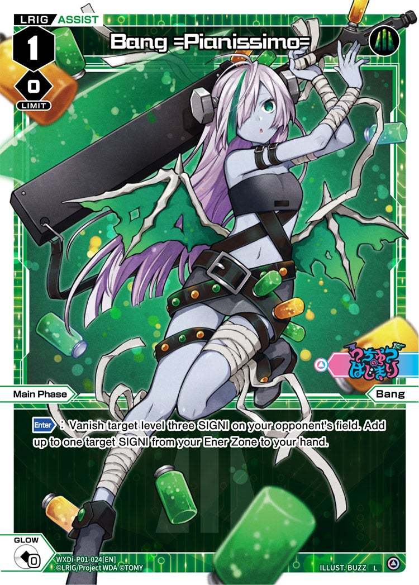

# Bang =Pianissimo=

## Thông tin lá

| Trường | Giá trị |
| --- | --- |
| Mã in | WXDi-P01-024[EN] |
| Set | WXDi-P01[EN] |
| Số thứ tự | 024 |
| Loại thẻ | ASSIST LRIG |
| Vị trí | LRIG Deck |
| Số bản | — (set booster, không áp dụng) |
| Màu | Xanh lá |
| Độ hiếm | L,L(P) |
| Minh họa | BUZZ |
| Level | 1 |
| Limit | 0 |
| Power | 0 |
| LRIG type / Class | Bang |
| Team / Master | UCHU NO HAJIMARI |
| Cost | — |
| Grow cost | 《C》×０ |
| Use timing | Main Phase |
| Life Burst | Không |

## Card text chính thức

[Enter]: Vanish target level three SIGNI on your opponent's field. Add up to one target SIGNI from your Ener Zone to your hand.

## Power text / Life Burst

—

## Ghi chú minh họa
Artist: BUZZ. Ảnh L được tải từ Card List tiếng Anh.

## FAQ chính thức

**Q. If there is no target SIGNI in opponent's field, can I add  SIGNI from Ener zone to my hand?**
A. Yes, you can. Even if there is no SIGNI that can be targeted by the first half of the effect, the second half of the effect will still be processed.

## Ảnh biến thể

- [L(P)](../images/WXDi-P01-024P-EN.jpg)

## Nguồn
[Card List/FAQ chính thức](https://www.takaratomy.co.jp/products/en.wixoss/card/card.html?card_no=WXDi-P01-024%5BEN%5D ) · [Ảnh thẻ](https://www.takaratomy.co.jp/products/en.wixoss/card/thumb/WXDi-P01-024%5BEN%5D.jpg)
