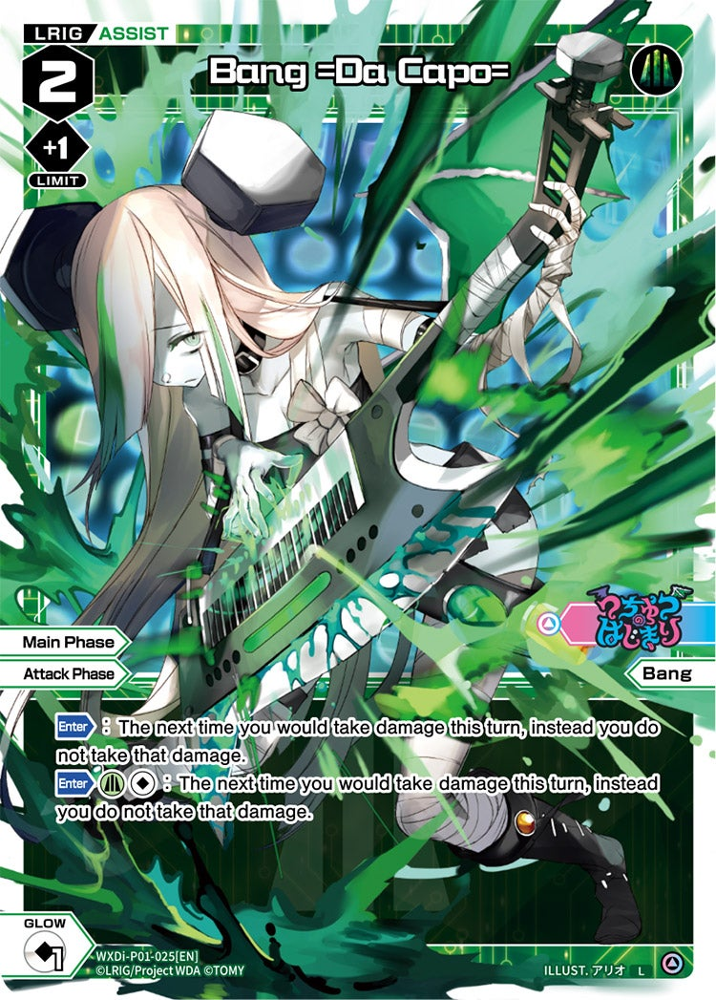

# Bang =Da Capo=

## Thông tin lá

| Trường | Giá trị |
| --- | --- |
| Mã in | WXDi-P01-025[EN] |
| Set | WXDi-P01[EN] |
| Số thứ tự | 025 |
| Loại thẻ | ASSIST LRIG |
| Vị trí | LRIG Deck |
| Số bản | — (set booster, không áp dụng) |
| Màu | Xanh lá |
| Độ hiếm | L,L(P) |
| Minh họa | アリオ |
| Level | 2 |
| Limit | ＋１ |
| Power | 0 |
| LRIG type / Class | Bang |
| Team / Master | UCHU NO HAJIMARI |
| Cost | — |
| Grow cost | 《C》×１ |
| Use timing | Main Phase / Attack Phase |
| Life Burst | Không |

## Card text chính thức

[Enter]: The next time you would take damage this turn, instead you do not take that damage.
[Enter] {Green} {Colorless}: The next time you would take damage this turn, instead you do not take that damage.

## Power text / Life Burst

—

## Ghi chú minh họa
Artist: アリオ. Ảnh L được tải từ Card List tiếng Anh.

## FAQ chính thức

**Q. If I activate both [Enter], will I be able to prevent damage twice?**
A. Yes, if you activate both, you will not take damage from the next and the one after that.

**Q. The turn I activated only [Enter] above, my opponent's SIGNI with [Double Crush] attacked. Will my Life Cloth be crushed?**
A. No, it will not be crashed. [Double Crush] does not deal damage twice, it is an ability that crashes two cards when it attacks and deals damage. It only deals damage once, and that one cannot deal damage by this effect.

## Ảnh biến thể

- [L(P)](../images/WXDi-P01-025P-EN.jpg)

## Nguồn
[Card List/FAQ chính thức](https://www.takaratomy.co.jp/products/en.wixoss/card/card.html?card_no=WXDi-P01-025%5BEN%5D ) · [Ảnh thẻ](https://www.takaratomy.co.jp/products/en.wixoss/card/thumb/WXDi-P01-025%5BEN%5D.jpg)
