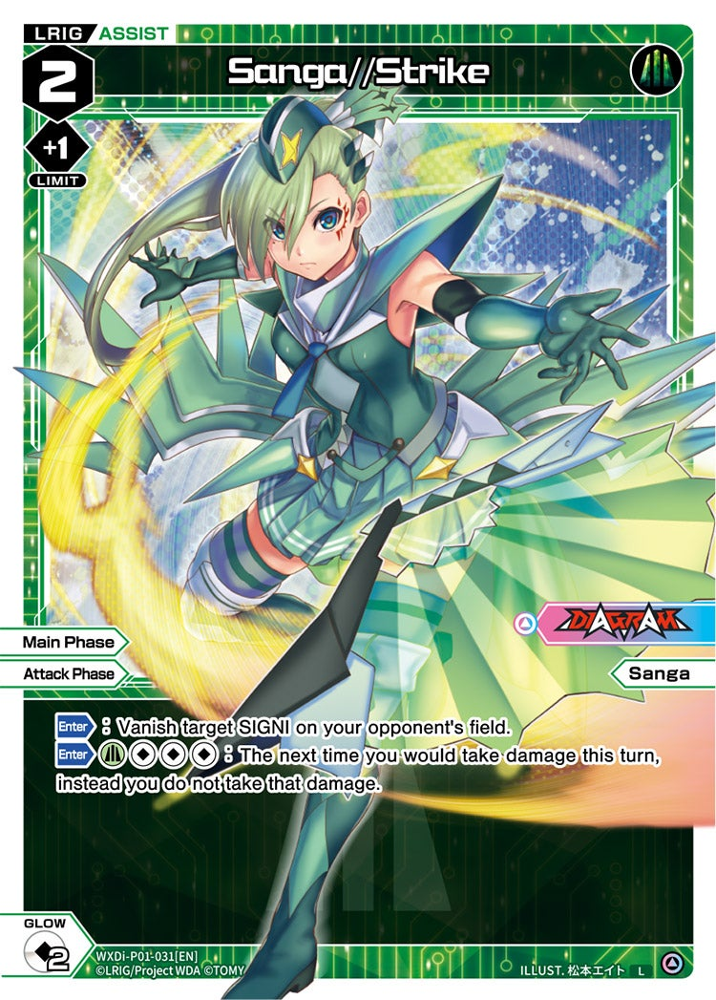

# Sanga//Strike

## Thông tin lá

| Trường | Giá trị |
| --- | --- |
| Mã in | WXDi-P01-031[EN] |
| Set | WXDi-P01[EN] |
| Số thứ tự | 031 |
| Loại thẻ | ASSIST LRIG |
| Vị trí | LRIG Deck |
| Số bản | — (set booster, không áp dụng) |
| Màu | Xanh lá |
| Độ hiếm | L,L(P) |
| Minh họa | 松本エイト |
| Level | 2 |
| Limit | ＋１ |
| Power | 0 |
| LRIG type / Class | Sanga |
| Team / Master | DIAGRAM |
| Cost | — |
| Grow cost | 《C》×２ |
| Use timing | Main Phase / Attack Phase |
| Life Burst | Không |

## Card text chính thức

[Enter]: Vanish target SIGNI on your opponent's field.
[Enter] {Green} {Colorless} {Colorless} {Colorless}: The next time you would take damage this turn, instead you do not take that damage.

## Power text / Life Burst

—

## Ghi chú minh họa
Artist: 松本エイト. Ảnh L được tải từ Card List tiếng Anh.

## FAQ chính thức

**Q. The turn I activated [Enter] below, my opponent's SIGNI with [Double Crush] attacked. Will my Life Cloth be crushed?**
A. No, it will not be crashed. [Double Crush] does not deal damage twice, but rather crashes two cards when it attacks and deals damage. It only deals damage once, so that one damage is prevented by this ability.

## Ảnh biến thể

- [L(P)](../images/WXDi-P01-031P-EN.jpg)

## Nguồn
[Card List/FAQ chính thức](https://www.takaratomy.co.jp/products/en.wixoss/card/card.html?card_no=WXDi-P01-031%5BEN%5D ) · [Ảnh thẻ](https://www.takaratomy.co.jp/products/en.wixoss/card/thumb/WXDi-P01-031%5BEN%5D.jpg)
