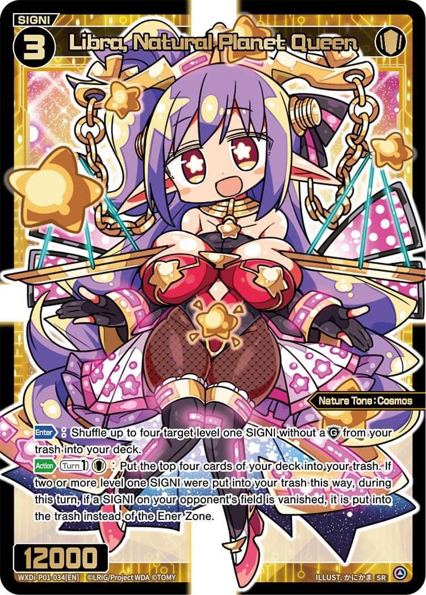

# Libra, Natural Planet Queen

## Thông tin lá

| Trường | Giá trị |
| --- | --- |
| Mã in | WXDi-P01-034[EN] |
| Set | WXDi-P01[EN] |
| Số thứ tự | 034 |
| Loại thẻ | SIGNI |
| Vị trí | Main Deck |
| Số bản | — (set booster, không áp dụng) |
| Màu | Trắng |
| Độ hiếm | SR |
| Minh họa | かにかま |
| Level | 3 |
| Limit | — |
| Power | 12000 |
| LRIG type / Class | Nature Tone：Cosmos |
| Team / Master | — |
| Cost | — |
| Grow cost | — |
| Use timing | — |
| Life Burst | Không |

## Card text chính thức

[Enter]: Shuffle up to four target level one SIGNI without a {Guard Icon} from your trash into your deck.
[Action] {1/Turn} {White}: Put the top four cards of your deck into your trash. If two or more level one SIGNI were put into your trash this way, during this turn, if a SIGNI on your opponent's field is vanished, it is put into the trash instead of the Ener Zone.

## Power text / Life Burst

—

## Ghi chú minh họa
Artist: かにかま. Ảnh SR được tải từ Card List tiếng Anh.

## FAQ chính thức

**Q. When I activate [Enter] of this SIGNI, can I not return any cards from trash into my deck?**
A. Yes, since the effect targets "up to" four cards, you can choose not to target any cards. However, in that case, you still have to shuffle the cards.

## Nguồn
[Card List/FAQ chính thức](https://www.takaratomy.co.jp/products/en.wixoss/card/card.html?card_no=WXDi-P01-034%5BEN%5D ) · [Ảnh thẻ](https://www.takaratomy.co.jp/products/en.wixoss/card/thumb/WXDi-P01-034%5BEN%5D.jpg)
