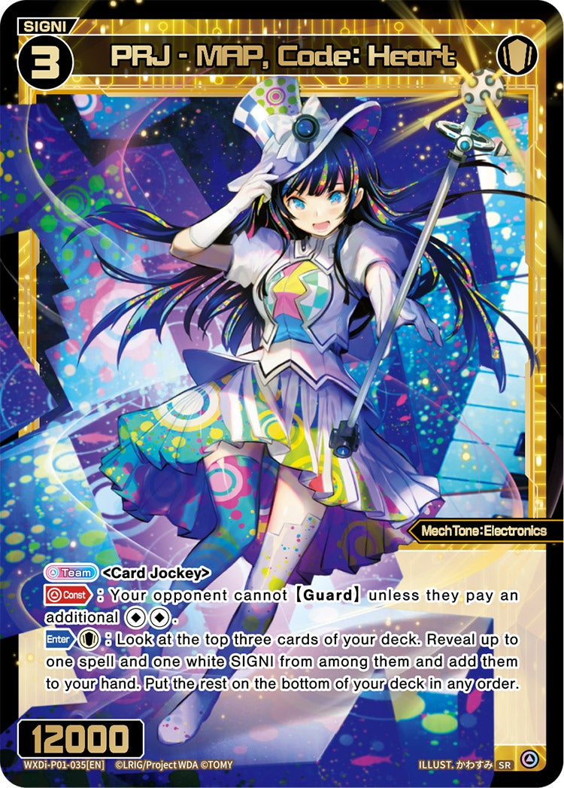

# PRJ - MAP, Code: Heart

## Thông tin lá

| Trường | Giá trị |
| --- | --- |
| Mã in | WXDi-P01-035[EN] |
| Set | WXDi-P01[EN] |
| Số thứ tự | 035 |
| Loại thẻ | SIGNI |
| Vị trí | Main Deck |
| Số bản | — (set booster, không áp dụng) |
| Màu | Trắng |
| Độ hiếm | SR |
| Minh họa | かわすみ |
| Level | 3 |
| Limit | — |
| Power | 12000 |
| LRIG type / Class | Mech Tone：Electronics |
| Team / Master | — |
| Cost | — |
| Grow cost | — |
| Use timing | — |
| Life Burst | Không |

## Card text chính thức

[Team] <Card Jockey>
[Team Constant]: Your opponent cannot 【Guard】 unless they pay an additional {Colorless} {Colorless}.
[Enter] {White}: Look at the top three cards of your deck. Reveal up to one spell and one white SIGNI from among them and add them to your hand. Put the rest on the bottom of your deck in any order.

## Power text / Life Burst

—

## Ghi chú minh họa
Artist: かわすみ. Ảnh SR được tải từ Card List tiếng Anh.

## FAQ chính thức

**Q. What does it mean by [Team]?**
A. It means the team indicated by that card. The [Team Auto], [Team Action], [Team Constant], and [Team Enter] abilities of the card are valid only if all 3 LRIGs in your field are the indicated [Team].
In the case of this card, if all three of your LRIGs are <Card Jockey>, you will be able to use the [Team Constant] ability.

**Q. Will the [Team Constant] effect of this SIGNI be duplicated?**
A. Yes, it duplicated. If there are two of these SIGNI, the opponent needs {Colorless}{Colorless}{Colorless}{Colorless} to [guard].

## Nguồn
[Card List/FAQ chính thức](https://www.takaratomy.co.jp/products/en.wixoss/card/card.html?card_no=WXDi-P01-035%5BEN%5D ) · [Ảnh thẻ](https://www.takaratomy.co.jp/products/en.wixoss/card/thumb/WXDi-P01-035%5BEN%5D.jpg)
