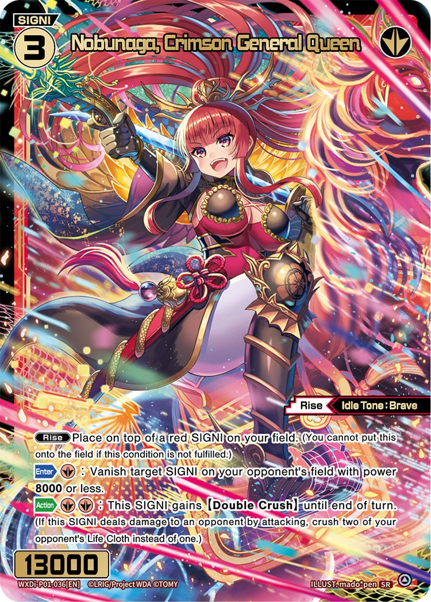

# Nobunaga, Crimson General Queen

## Thông tin lá

| Trường | Giá trị |
| --- | --- |
| Mã in | WXDi-P01-036[EN] |
| Set | WXDi-P01[EN] |
| Số thứ tự | 036 |
| Loại thẻ | SIGNI |
| Vị trí | Main Deck |
| Số bản | — (set booster, không áp dụng) |
| Màu | Đỏ |
| Độ hiếm | SR |
| Minh họa | mado*pen |
| Level | 3 |
| Limit | — |
| Power | 13000 |
| LRIG type / Class | Idol Tone：Brave |
| Team / Master | — |
| Cost | — |
| Grow cost | — |
| Use timing | — |
| Life Burst | Không |

## Card text chính thức

[Rise] Place on top of a red SIGNI on your field. (You cannot put this onto the field if this condition is not fulfilled.)
[Enter] {Red}: Vanish target SIGNI on your opponent's field with power 8000 or less.
[Action] {Red} {Red}: This SIGNI gains 【Double Crush】 until end of turn. (If this SIGNI deals damage to an opponent by attacking, crush two of your opponent's Life Cloth instead of one.)

## Power text / Life Burst

—

## Ghi chú minh họa
Artist: mado*pen. Ảnh SR được tải từ Card List tiếng Anh.

## FAQ chính thức

— (không có FAQ riêng cho mã này trên trang FAQ tiếng Anh.)

## Nguồn
[Card List/FAQ chính thức](https://www.takaratomy.co.jp/products/en.wixoss/card/card.html?card_no=WXDi-P01-036%5BEN%5D ) · [Ảnh thẻ](https://www.takaratomy.co.jp/products/en.wixoss/card/thumb/WXDi-P01-036%5BEN%5D.jpg)
