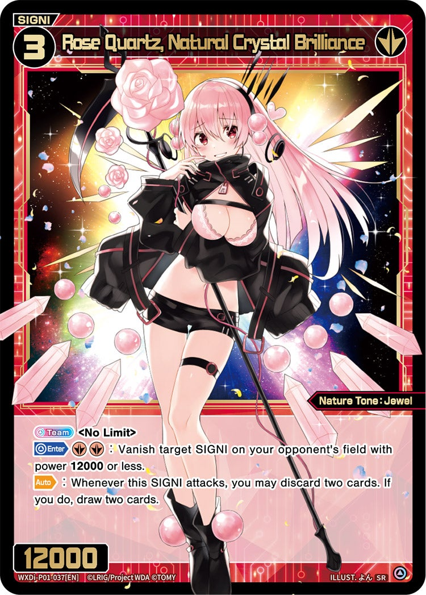

# Rose Quartz, Natural Crystal Brilliance

## Thông tin lá

| Trường | Giá trị |
| --- | --- |
| Mã in | WXDi-P01-037[EN] |
| Set | WXDi-P01[EN] |
| Số thứ tự | 037 |
| Loại thẻ | SIGNI |
| Vị trí | Main Deck |
| Số bản | — (set booster, không áp dụng) |
| Màu | Đỏ |
| Độ hiếm | SR |
| Minh họa | よん |
| Level | 3 |
| Limit | — |
| Power | 12000 |
| LRIG type / Class | Nature Tone：Jewel |
| Team / Master | — |
| Cost | — |
| Grow cost | — |
| Use timing | — |
| Life Burst | Không |

## Card text chính thức

[Team] <No Limit>
[Team Enter] {Red} {Red}: Vanish target SIGNI on your opponent's field with power 12000 or less.
[Auto]: Whenever this SIGNI attacks, you may discard two cards. If you do, draw two cards.

## Power text / Life Burst

—

## Ghi chú minh họa
Artist: よん. Ảnh SR được tải từ Card List tiếng Anh.

## FAQ chính thức

**Q. What does it mean by [Team]?**
A. It means the team indicated by that card. The [Team Auto], [Team Action], [Team Constant], and [Team Enter] abilities of the card are valid only if all 3 LRIGs in your field are the indicated [Team].
In the case of this card, if all three of your LRIGs are <No Limit>, you will be able to use the [Team Enter] ability.

## Nguồn
[Card List/FAQ chính thức](https://www.takaratomy.co.jp/products/en.wixoss/card/card.html?card_no=WXDi-P01-037%5BEN%5D ) · [Ảnh thẻ](https://www.takaratomy.co.jp/products/en.wixoss/card/thumb/WXDi-P01-037%5BEN%5D.jpg)
