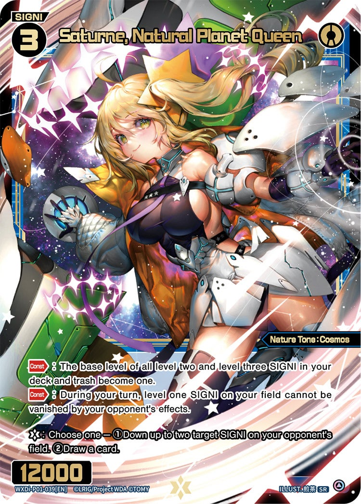

# Saturne, Natural Planet Queen

## Thông tin lá

| Trường | Giá trị |
| --- | --- |
| Mã in | WXDi-P01-039[EN] |
| Set | WXDi-P01[EN] |
| Số thứ tự | 039 |
| Loại thẻ | SIGNI |
| Vị trí | Main Deck |
| Số bản | — (set booster, không áp dụng) |
| Màu | Xanh dương |
| Độ hiếm | SR |
| Minh họa | 煎茶 |
| Level | 3 |
| Limit | — |
| Power | 12000 |
| LRIG type / Class | Nature Tone：Cosmos |
| Team / Master | — |
| Cost | — |
| Grow cost | — |
| Use timing | — |
| Life Burst | Có |

## Card text chính thức

[Constant]: The base level of all level two and level three SIGNI in your deck and trash become one.
[Constant]: During your turn, level one SIGNI on your field cannot be vanished by your opponent's effects.

## Power text / Life Burst

Choose one — ①Down up to two target SIGNI on your opponent's field. ②Draw a card.

## Ghi chú minh họa
Artist: 煎茶. Ảnh SR được tải từ Card List tiếng Anh.

## FAQ chính thức

**Q. What exactly is the effect of [Constant] above?**
A. Since the base level of level 3 and level 2 SIGNIs in the deck and trash is become to 1, for example, an effect that searches for a level 1 SIGNI from the deck or adds a level 1 SIGNI from the trash to your hand can choose a SIGNI that was originally level 3 or level 2.

**Q. Does bottom's [Constant]  can prevent vanish by battle, or vanish when power is minus and power is reduced to 0?**
A. No, it cannnot. Both of the patterns in the question are based on the rules, and are not "Vanished by opponent's effect".

## Nguồn
[Card List/FAQ chính thức](https://www.takaratomy.co.jp/products/en.wixoss/card/card.html?card_no=WXDi-P01-039%5BEN%5D ) · [Ảnh thẻ](https://www.takaratomy.co.jp/products/en.wixoss/card/thumb/WXDi-P01-039%5BEN%5D.jpg)
