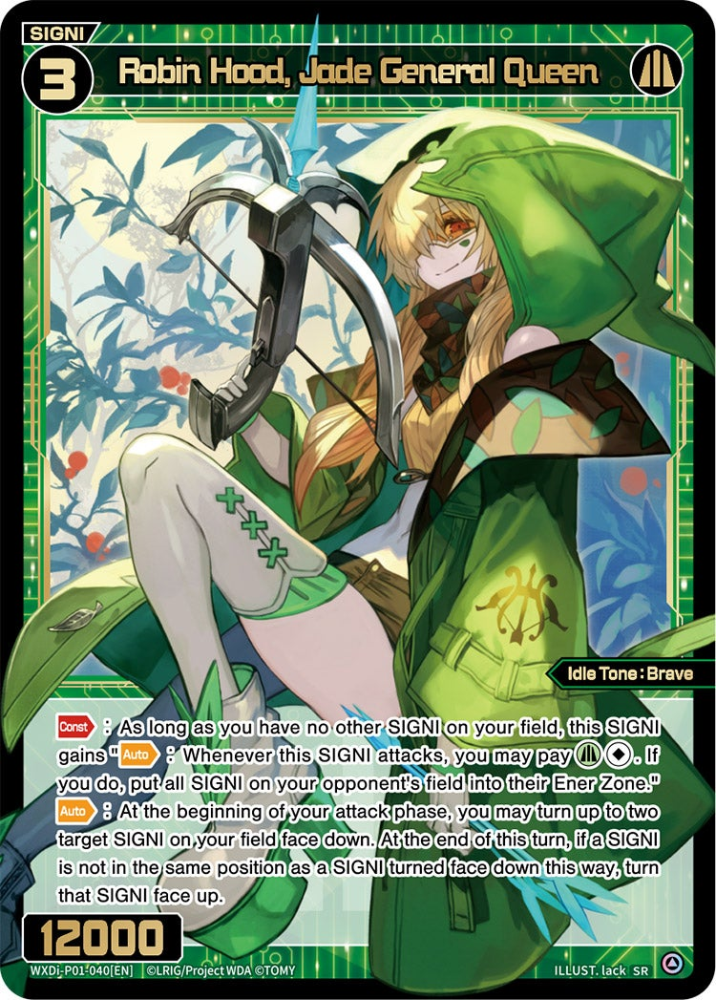

# Robin Hood, Jade General Queen

## Thông tin lá

| Trường | Giá trị |
| --- | --- |
| Mã in | WXDi-P01-040[EN] |
| Set | WXDi-P01[EN] |
| Số thứ tự | 040 |
| Loại thẻ | SIGNI |
| Vị trí | Main Deck |
| Số bản | — (set booster, không áp dụng) |
| Màu | Xanh lá |
| Độ hiếm | SR |
| Minh họa | lack |
| Level | 3 |
| Limit | — |
| Power | 12000 |
| LRIG type / Class | Idol Tone：Brave |
| Team / Master | — |
| Cost | — |
| Grow cost | — |
| Use timing | — |
| Life Burst | Không |

## Card text chính thức

[Constant]: As long as you have no other SIGNI on your field, this SIGNI gains "[Auto]: Whenever this SIGNI attacks, you may pay {Green} {Colorless}. If you do, put all SIGNI on your opponent's field into their Ener Zone."
[Auto]: At the beginning of your attack phase, you may turn up to two target SIGNI on your field face down. At the end of this turn, if a SIGNI is not in the same position as a SIGNI turned face down this way, turn that SIGNI face up.

## Power text / Life Burst

—

## Ghi chú minh họa
Artist: lack. Ảnh SR được tải từ Card List tiếng Anh.

## FAQ chính thức

**Q. Are cards that are turned face-down by [Auto] treated as SIGNI?**
A. No, the card placed face down is not treated as a SIGNI, so you cannot select it with an effect that vanishes it or returns it to hand.

**Q. If I turn a face-down SIGNI face-up, will that SIGNI's [Enter] be activated?**
A. No, it doesn't trigger because it's not newly in the field.

**Q. If I place a SIGNI in the same place as a SIGNI that was turned face down, and I cannot turn it face up, what happens to that face down card?**
A. In that case, the card remains face down. The card can only be turned face-up at the end of the turn in which it is turned face-down, so even if there is no SIGNI in the same place in subsequent turns, it cannot be turned face-up.

**Q. After I face-down a SIGNI with [Auto], This 《Robin Hood, Jade General Queen》 left the field during the same turn. At the end of the turn, what happens to the SIGNI that was face-downed?**
A. Even if 《Robin Hood, Jade General Queen》 leaves the field or loses its ability, the face-downed SIGNI will turn face-up at the end of its turn.

## Nguồn
[Card List/FAQ chính thức](https://www.takaratomy.co.jp/products/en.wixoss/card/card.html?card_no=WXDi-P01-040%5BEN%5D ) · [Ảnh thẻ](https://www.takaratomy.co.jp/products/en.wixoss/card/thumb/WXDi-P01-040%5BEN%5D.jpg)
