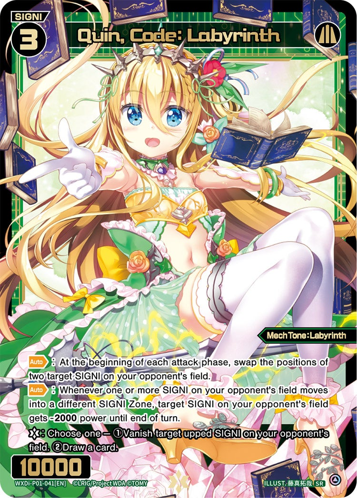

# Quin, Code: Labyrinth

## Thông tin lá

| Trường | Giá trị |
| --- | --- |
| Mã in | WXDi-P01-041[EN] |
| Set | WXDi-P01[EN] |
| Số thứ tự | 041 |
| Loại thẻ | SIGNI |
| Vị trí | Main Deck |
| Số bản | — (set booster, không áp dụng) |
| Màu | Xanh lá |
| Độ hiếm | SR |
| Minh họa | 藤真拓哉 |
| Level | 3 |
| Limit | — |
| Power | 10000 |
| LRIG type / Class | Mech Tone：Labyrinth |
| Team / Master | — |
| Cost | — |
| Grow cost | — |
| Use timing | — |
| Life Burst | Có |

## Card text chính thức

[Auto]: At the beginning of each attack phase, swap the positions of two target SIGNI on your opponent's field.
[Auto]: Whenever one or more SIGNI on your opponent's field moves into a different SIGNI Zone, target SIGNI on your opponent's field gets -2000 power until end of turn.

## Power text / Life Burst

Choose one — ①Vanish target upped SIGNI on your opponent's field. ②Draw a card.

## Ghi chú minh họa
Artist: 藤真拓哉. Ảnh SR được tải từ Card List tiếng Anh.

## FAQ chính thức

**Q. When I activated [Auto] above, my opponent had only one SIGNI. Can I change the placement of that SIGNI?**
A. No, you cannot. If your opponent doesn't have two SIGNI, you can't target one of them, so nothing happens in that case.

**Q. How many times will the lower [Auto] be activated if the upper [Auto] swaps the locations of the opponent's two SIGNI?**
A. It will be triggered once. In the case of effects that move at the same time, the bottom [Auto] triggers once, as if one or more of them had moved.

## Nguồn
[Card List/FAQ chính thức](https://www.takaratomy.co.jp/products/en.wixoss/card/card.html?card_no=WXDi-P01-041%5BEN%5D ) · [Ảnh thẻ](https://www.takaratomy.co.jp/products/en.wixoss/card/thumb/WXDi-P01-041%5BEN%5D.jpg)
