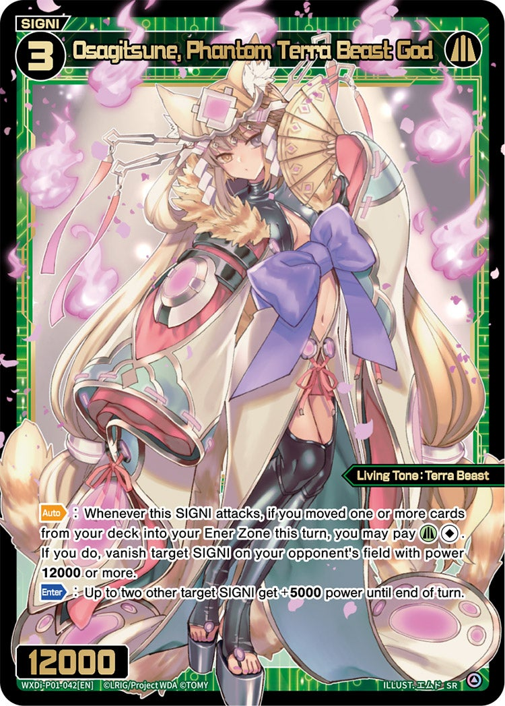

# Osagitsune, Phantom Terra Beast God

## Thông tin lá

| Trường | Giá trị |
| --- | --- |
| Mã in | WXDi-P01-042[EN] |
| Set | WXDi-P01[EN] |
| Số thứ tự | 042 |
| Loại thẻ | SIGNI |
| Vị trí | Main Deck |
| Số bản | — (set booster, không áp dụng) |
| Màu | Xanh lá |
| Độ hiếm | SR |
| Minh họa | エムド |
| Level | 3 |
| Limit | — |
| Power | 12000 |
| LRIG type / Class | Living Tone：Terra Beast |
| Team / Master | — |
| Cost | — |
| Grow cost | — |
| Use timing | — |
| Life Burst | Không |

## Card text chính thức

[Auto]: Whenever this SIGNI attacks, if you moved one or more cards from your deck into your Ener Zone this turn, you may pay {Green} {Colorless}. If you do, vanish target SIGNI on your opponent's field with power 12000 or more.
[Enter]: Up to two other target SIGNI get +5000 power until end of turn.

## Power text / Life Burst

—

## Ghi chú minh họa
Artist: エムド. Ảnh SR được tải từ Card List tiếng Anh.

## FAQ chính thức

**Q. Can opponent's SIGNI also be +5000?**
A. Yes, you can.

## Nguồn
[Card List/FAQ chính thức](https://www.takaratomy.co.jp/products/en.wixoss/card/card.html?card_no=WXDi-P01-042%5BEN%5D ) · [Ảnh thẻ](https://www.takaratomy.co.jp/products/en.wixoss/card/thumb/WXDi-P01-042%5BEN%5D.jpg)
