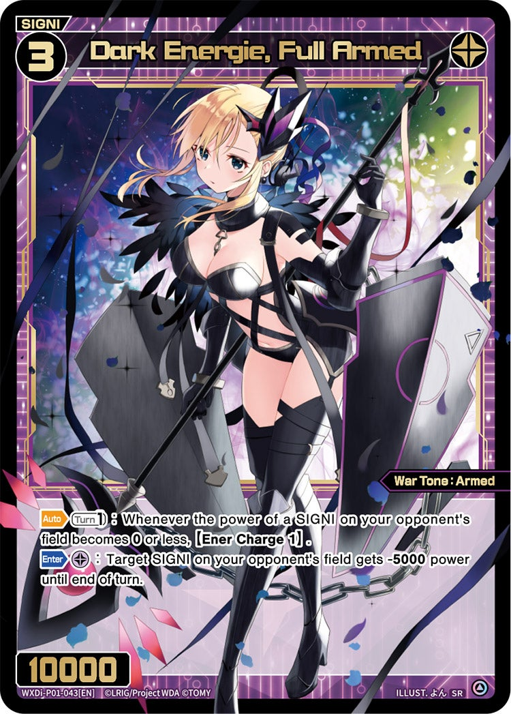

# Dark Energie, Full Armed

## Thông tin lá

| Trường | Giá trị |
| --- | --- |
| Mã in | WXDi-P01-043[EN] |
| Set | WXDi-P01[EN] |
| Số thứ tự | 043 |
| Loại thẻ | SIGNI |
| Vị trí | Main Deck |
| Số bản | — (set booster, không áp dụng) |
| Màu | Đen |
| Độ hiếm | SR |
| Minh họa | よん |
| Level | 3 |
| Limit | — |
| Power | 10000 |
| LRIG type / Class | War Tone：Armed |
| Team / Master | — |
| Cost | — |
| Grow cost | — |
| Use timing | — |
| Life Burst | Không |

## Card text chính thức

[Auto] {1/Turn}: Whenever the power of a SIGNI on your opponent's field becomes 0 or less, 【Ener Charge 1】.
[Enter] {Black}: Target SIGNI on your opponent's field gets -5000 power until end of turn.

## Power text / Life Burst

—

## Ghi chú minh họa
Artist: よん. Ảnh SR được tải từ Card List tiếng Anh.

## FAQ chính thức

— (không có FAQ riêng cho mã này trên trang FAQ tiếng Anh.)

## Nguồn
[Card List/FAQ chính thức](https://www.takaratomy.co.jp/products/en.wixoss/card/card.html?card_no=WXDi-P01-043%5BEN%5D ) · [Ảnh thẻ](https://www.takaratomy.co.jp/products/en.wixoss/card/thumb/WXDi-P01-043%5BEN%5D.jpg)
