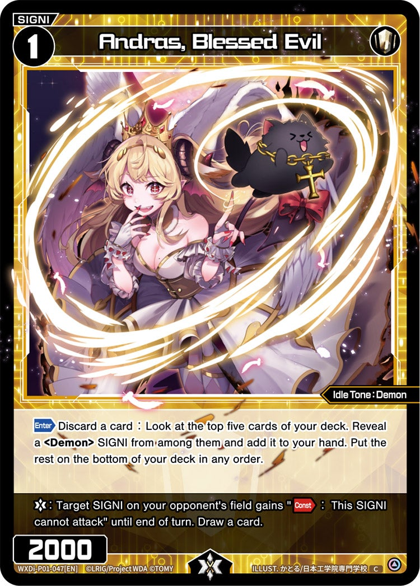

# Andras, Blessed Evil

## Thông tin lá

| Trường | Giá trị |
| --- | --- |
| Mã in | WXDi-P01-047[EN] |
| Set | WXDi-P01[EN] |
| Số thứ tự | 047 |
| Loại thẻ | SIGNI |
| Vị trí | Main Deck |
| Số bản | — (set booster, không áp dụng) |
| Màu | Trắng |
| Độ hiếm | C,C(P) |
| Minh họa | かとる/日本工学院専門学校 |
| Level | 1 |
| Limit | — |
| Power | 2000 |
| LRIG type / Class | Idol Tone：Demon |
| Team / Master | — |
| Cost | — |
| Grow cost | — |
| Use timing | — |
| Life Burst | Có |

## Card text chính thức

[Enter] Discard a card: Look at the top five cards of your deck. Reveal a <Demon> SIGNI from among them and add it to your hand. Put the rest on the bottom of your deck in any order.

## Power text / Life Burst

Target SIGNI on your opponent's field gains "[Constant]: This SIGNI cannot attack" until end of turn. Draw a card.

## Ghi chú minh họa
Artist: かとる/日本工学院専門学校. Ảnh C được tải từ Card List tiếng Anh.

## FAQ chính thức

**Q. When Life Burst is triggered, can I draw a card even if my opponent has no SIGNI?**
A. Yes, you can draw a card.

## Ảnh biến thể

- [C(P)](../images/WXDi-P01-047P-EN.jpg)

## Nguồn
[Card List/FAQ chính thức](https://www.takaratomy.co.jp/products/en.wixoss/card/card.html?card_no=WXDi-P01-047%5BEN%5D ) · [Ảnh thẻ](https://www.takaratomy.co.jp/products/en.wixoss/card/thumb/WXDi-P01-047%5BEN%5D.jpg)
