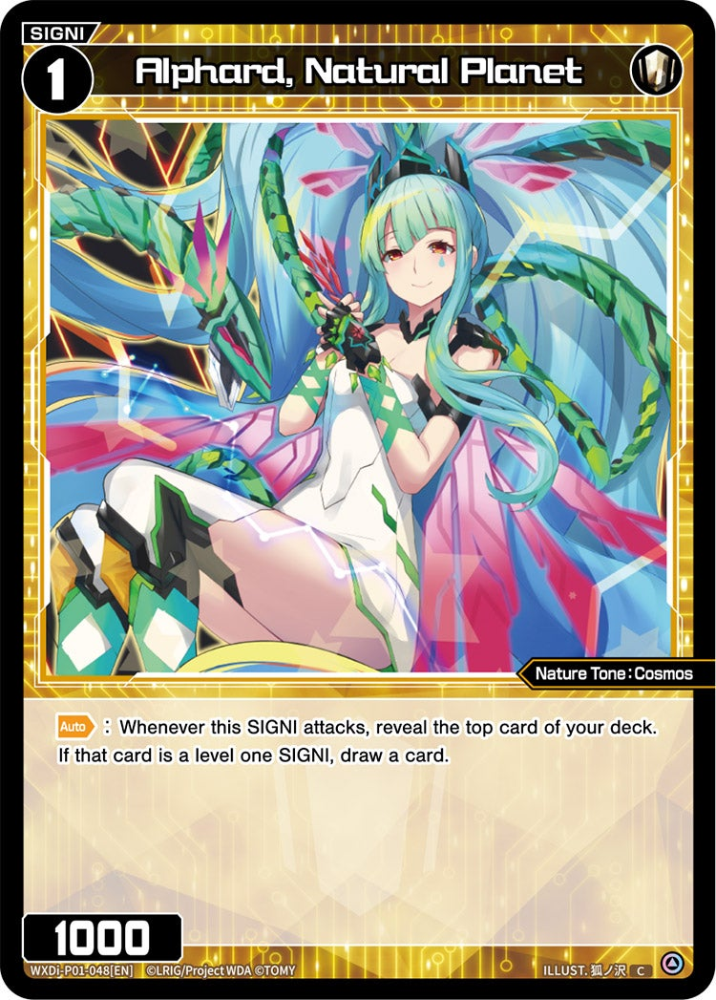

# Alphard, Natural Planet

## Thông tin lá

| Trường | Giá trị |
| --- | --- |
| Mã in | WXDi-P01-048[EN] |
| Set | WXDi-P01[EN] |
| Số thứ tự | 048 |
| Loại thẻ | SIGNI |
| Vị trí | Main Deck |
| Số bản | — (set booster, không áp dụng) |
| Màu | Trắng |
| Độ hiếm | C,C(P) |
| Minh họa | 狐ノ沢 |
| Level | 1 |
| Limit | — |
| Power | 1000 |
| LRIG type / Class | Nature Tone：Cosmos |
| Team / Master | — |
| Cost | — |
| Grow cost | — |
| Use timing | — |
| Life Burst | Không |

## Card text chính thức

[Auto]: Whenever this SIGNI attacks, reveal the top card of your deck. If that card is a level one SIGNI, draw a card.

## Power text / Life Burst

—

## Ghi chú minh họa
Artist: 狐ノ沢. Ảnh C được tải từ Card List tiếng Anh.

## FAQ chính thức

**Q. If the revealed card fit the requrement, do I add that revealed card to my hand?**
A. Yes, you draw that revealed card.

**Q. If the revealed card doesn't fit the requrement, does the revealed card remain revealed afterwards?**
A. No, after checking the card, it will be turned back face down after processing this [Auto] ability.

## Ảnh biến thể

- [C(P)](../images/WXDi-P01-048P-EN.jpg)

## Nguồn
[Card List/FAQ chính thức](https://www.takaratomy.co.jp/products/en.wixoss/card/card.html?card_no=WXDi-P01-048%5BEN%5D ) · [Ảnh thẻ](https://www.takaratomy.co.jp/products/en.wixoss/card/thumb/WXDi-P01-048%5BEN%5D.jpg)
