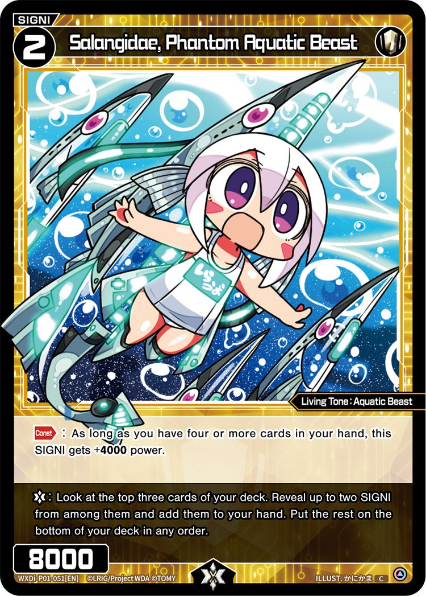

# Salangidae, Phantom Aquatic Beast

## Thông tin lá

| Trường | Giá trị |
| --- | --- |
| Mã in | WXDi-P01-051[EN] |
| Set | WXDi-P01[EN] |
| Số thứ tự | 051 |
| Loại thẻ | SIGNI |
| Vị trí | Main Deck |
| Số bản | — (set booster, không áp dụng) |
| Màu | Trắng |
| Độ hiếm | C,C(P) |
| Minh họa | かにかま |
| Level | 2 |
| Limit | — |
| Power | 8000 |
| LRIG type / Class | Living Tone：Aquatic Beast |
| Team / Master | — |
| Cost | — |
| Grow cost | — |
| Use timing | — |
| Life Burst | Có |

## Card text chính thức

[Constant]: As long as you have four or more cards in your hand, this SIGNI gets +4000 power.

## Power text / Life Burst

Look at the top three cards of your deck. Reveal up to two SIGNI from among them and add them to your hand. Put the rest on the bottom of your deck in any order.

## Ghi chú minh họa
Artist: かにかま. Ảnh C được tải từ Card List tiếng Anh.

## FAQ chính thức

— (không có FAQ riêng cho mã này trên trang FAQ tiếng Anh.)

## Ảnh biến thể

- [C(P)](../images/WXDi-P01-051P-EN.jpg)

## Nguồn
[Card List/FAQ chính thức](https://www.takaratomy.co.jp/products/en.wixoss/card/card.html?card_no=WXDi-P01-051%5BEN%5D ) · [Ảnh thẻ](https://www.takaratomy.co.jp/products/en.wixoss/card/thumb/WXDi-P01-051%5BEN%5D.jpg)
