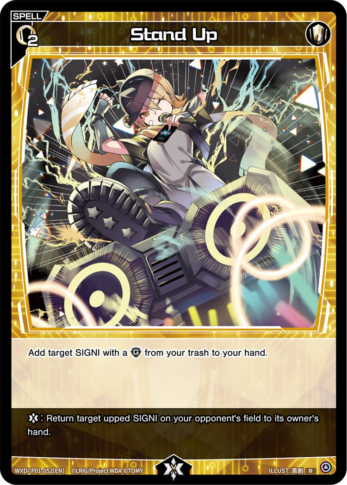

# Stand Up

## Thông tin lá

| Trường | Giá trị |
| --- | --- |
| Mã in | WXDi-P01-052[EN] |
| Set | WXDi-P01[EN] |
| Số thứ tự | 052 |
| Loại thẻ | SPELL |
| Vị trí | Main Deck |
| Số bản | — (set booster, không áp dụng) |
| Màu | Trắng |
| Độ hiếm | R,R(P) |
| Minh họa | 斎創 |
| Level | — |
| Limit | — |
| Power | 0 |
| LRIG type / Class | — |
| Team / Master | — |
| Cost | 《W》×２ |
| Grow cost | — |
| Use timing | — |
| Life Burst | Có |

## Card text chính thức

Add target SIGNI with a {Guard Icon} from your trash to your hand.

## Power text / Life Burst

Return target upped SIGNI on your opponent's field to its owner's hand.

## Ghi chú minh họa
Artist: 斎創. Ảnh R được tải từ Card List tiếng Anh.

## FAQ chính thức

**Q. Can I add a card I paid as Ener Cost of this spell to my hand by its effect?**
A. Yes, you can. You pay the cost and then target it, so if it is a SIGNI that meets the condition, it will be targeted and added to your hand.

## Ảnh biến thể

- [R(P)](../images/WXDi-P01-052P-EN.jpg)

## Nguồn
[Card List/FAQ chính thức](https://www.takaratomy.co.jp/products/en.wixoss/card/card.html?card_no=WXDi-P01-052%5BEN%5D ) · [Ảnh thẻ](https://www.takaratomy.co.jp/products/en.wixoss/card/thumb/WXDi-P01-052%5BEN%5D.jpg)
