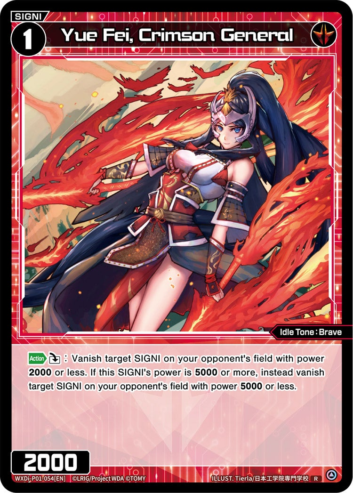

# Yue Fei, Crimson General

## Thông tin lá

| Trường | Giá trị |
| --- | --- |
| Mã in | WXDi-P01-054[EN] |
| Set | WXDi-P01[EN] |
| Số thứ tự | 054 |
| Loại thẻ | SIGNI |
| Vị trí | Main Deck |
| Số bản | — (set booster, không áp dụng) |
| Màu | Đỏ |
| Độ hiếm | R,R(P) |
| Minh họa | Tierla/日本工学院専門学校 |
| Level | 1 |
| Limit | — |
| Power | 2000 |
| LRIG type / Class | Idol Tone：Brave |
| Team / Master | — |
| Cost | — |
| Grow cost | — |
| Use timing | — |
| Life Burst | Không |

## Card text chính thức

[Action] {Down}: Vanish target SIGNI on your opponent's field with power 2000 or less. If this SIGNI's power is 5000 or more, instead vanish target SIGNI on your opponent's field with power 5000 or less.

## Power text / Life Burst

—

## Ghi chú minh họa
Artist: Tierla/日本工学院専門学校. Ảnh R được tải từ Card List tiếng Anh.

## FAQ chính thức

— (không có FAQ riêng cho mã này trên trang FAQ tiếng Anh.)

## Ảnh biến thể

- [R(P)](../images/WXDi-P01-054P-EN.jpg)

## Nguồn
[Card List/FAQ chính thức](https://www.takaratomy.co.jp/products/en.wixoss/card/card.html?card_no=WXDi-P01-054%5BEN%5D ) · [Ảnh thẻ](https://www.takaratomy.co.jp/products/en.wixoss/card/thumb/WXDi-P01-054%5BEN%5D.jpg)
