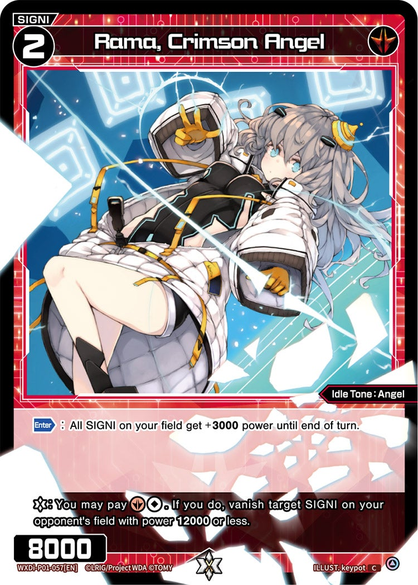

# Rama, Crimson Angel

## Thông tin lá

| Trường | Giá trị |
| --- | --- |
| Mã in | WXDi-P01-057[EN] |
| Set | WXDi-P01[EN] |
| Số thứ tự | 057 |
| Loại thẻ | SIGNI |
| Vị trí | Main Deck |
| Số bản | — (set booster, không áp dụng) |
| Màu | Đỏ |
| Độ hiếm | C,C(P) |
| Minh họa | keypot |
| Level | 2 |
| Limit | — |
| Power | 8000 |
| LRIG type / Class | Idol Tone：Angel |
| Team / Master | — |
| Cost | — |
| Grow cost | — |
| Use timing | — |
| Life Burst | Có |

## Card text chính thức

[Enter]: All SIGNI on your field get +3000 power until end of turn.

## Power text / Life Burst

You may pay {Red} {Colorless}. If you do, vanish target SIGNI on your opponent's field with power 12000 or less.

## Ghi chú minh họa
Artist: keypot. Ảnh C được tải từ Card List tiếng Anh.

## FAQ chính thức

**Q. If I put SIGNI on the field after [Enter] is triggered, does it get +3000?**
A. No, it does not. This [Enter] is only +3000 for SIGNI in your field when it is activated.

## Ảnh biến thể

- [C(P)](../images/WXDi-P01-057P-EN.jpg)

## Nguồn
[Card List/FAQ chính thức](https://www.takaratomy.co.jp/products/en.wixoss/card/card.html?card_no=WXDi-P01-057%5BEN%5D ) · [Ảnh thẻ](https://www.takaratomy.co.jp/products/en.wixoss/card/thumb/WXDi-P01-057%5BEN%5D.jpg)
