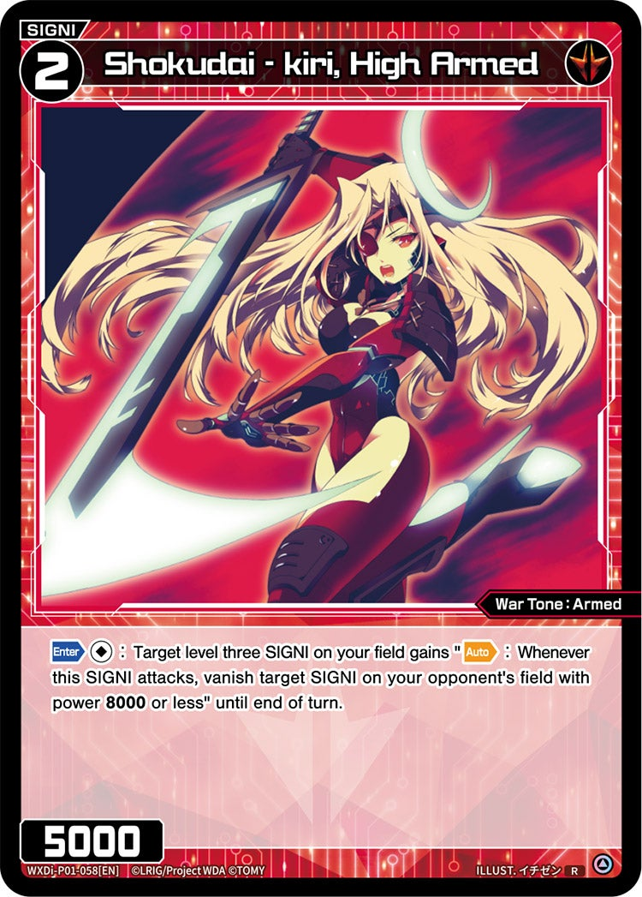

# Shokudai - kiri, High Armed

## Thông tin lá

| Trường | Giá trị |
| --- | --- |
| Mã in | WXDi-P01-058[EN] |
| Set | WXDi-P01[EN] |
| Số thứ tự | 058 |
| Loại thẻ | SIGNI |
| Vị trí | Main Deck |
| Số bản | — (set booster, không áp dụng) |
| Màu | Đỏ |
| Độ hiếm | R,R(P) |
| Minh họa | イチゼン |
| Level | 2 |
| Limit | — |
| Power | 5000 |
| LRIG type / Class | War Tone：Armed |
| Team / Master | — |
| Cost | — |
| Grow cost | — |
| Use timing | — |
| Life Burst | Không |

## Card text chính thức

[Enter] {Colorless}: Target level three SIGNI on your field gains "[Auto]: Whenever this SIGNI attacks, vanish target SIGNI on your opponent's field with power 8000 or less" until end of turn.

## Power text / Life Burst

—

## Ghi chú minh họa
Artist: イチゼン. Ảnh R được tải từ Card List tiếng Anh.

## FAQ chính thức

**Q. I placed two of these SIGNIs and targeted the same SIGNI with [Enter]. When that SIGNI attacks, will two [Auto] be activated?**
A. Yes, each of the two 《Shokudai - kiri, High Armed》 gives an [Auto] ability, so each will be activated.

## Ảnh biến thể

- [R(P)](../images/WXDi-P01-058P-EN.jpg)

## Nguồn
[Card List/FAQ chính thức](https://www.takaratomy.co.jp/products/en.wixoss/card/card.html?card_no=WXDi-P01-058%5BEN%5D ) · [Ảnh thẻ](https://www.takaratomy.co.jp/products/en.wixoss/card/thumb/WXDi-P01-058%5BEN%5D.jpg)
