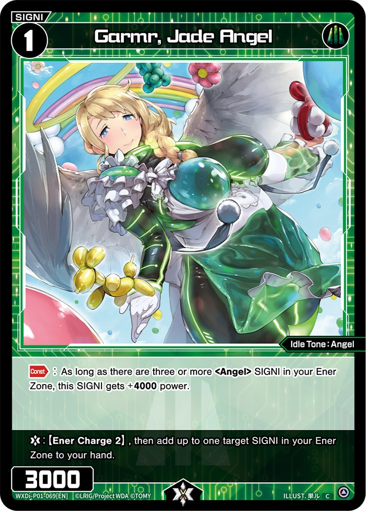

# Garmr, Jade Angel

## Thông tin lá

| Trường | Giá trị |
| --- | --- |
| Mã in | WXDi-P01-069[EN] |
| Set | WXDi-P01[EN] |
| Số thứ tự | 069 |
| Loại thẻ | SIGNI |
| Vị trí | Main Deck |
| Số bản | — (set booster, không áp dụng) |
| Màu | Xanh lá |
| Độ hiếm | C,C(P) |
| Minh họa | 単ル |
| Level | 1 |
| Limit | — |
| Power | 3000 |
| LRIG type / Class | Idol Tone：Angel |
| Team / Master | — |
| Cost | — |
| Grow cost | — |
| Use timing | — |
| Life Burst | Có |

## Card text chính thức

[Constant]: As long as there are three or more <Angel> SIGNI in your Ener Zone, this SIGNI gets +4000 power.

## Power text / Life Burst

【Ener Charge 2】, then add up to one target SIGNI in your Ener Zone to your hand.

## Ghi chú minh họa
Artist: 単ル. Ảnh C được tải từ Card List tiếng Anh.

## FAQ chính thức

**Q. In Life Burst, can I add cards newly placed in the Ener Zone by [Ener Charge 2] to my hand?**
A. Yes, you can select the newly placed card by performing [Energize Charge 2] and then targeting the SIGNI in the Ener zone.

## Ảnh biến thể

- [C(P)](../images/WXDi-P01-069P-EN.jpg)

## Nguồn
[Card List/FAQ chính thức](https://www.takaratomy.co.jp/products/en.wixoss/card/card.html?card_no=WXDi-P01-069%5BEN%5D ) · [Ảnh thẻ](https://www.takaratomy.co.jp/products/en.wixoss/card/thumb/WXDi-P01-069%5BEN%5D.jpg)
