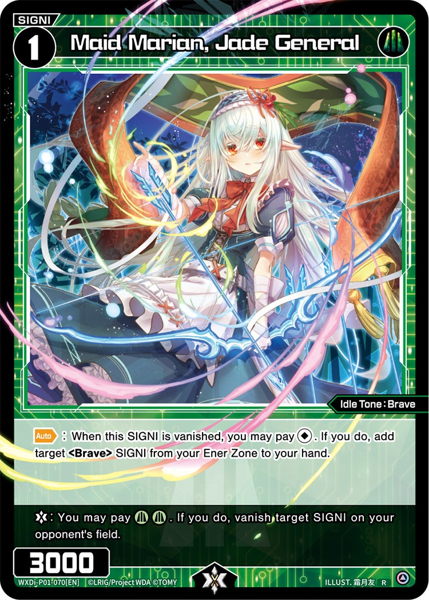

# Maid Marian, Jade General

## Thông tin lá

| Trường | Giá trị |
| --- | --- |
| Mã in | WXDi-P01-070[EN] |
| Set | WXDi-P01[EN] |
| Số thứ tự | 070 |
| Loại thẻ | SIGNI |
| Vị trí | Main Deck |
| Số bản | — (set booster, không áp dụng) |
| Màu | Xanh lá |
| Độ hiếm | R,R(P) |
| Minh họa | 霜月友 |
| Level | 1 |
| Limit | — |
| Power | 3000 |
| LRIG type / Class | Idol Tone：Brave |
| Team / Master | — |
| Cost | — |
| Grow cost | — |
| Use timing | — |
| Life Burst | Có |

## Card text chính thức

[Auto]: When this SIGNI is vanished, you may pay {Colorless}. If you do, add target <Brave> SIGNI from your Ener Zone to your hand.

## Power text / Life Burst

You may pay {Green} {Green}. If you do, vanish target SIGNI on your opponent's field.

## Ghi chú minh họa
Artist: 霜月友. Ảnh R được tải từ Card List tiếng Anh.

## FAQ chính thức

**Q. Can I add this vanished SIGNI to my hand?**
A. Yes, this ability is triggered after being vanished, and at that time, this SIGNI is in the "Ener zone" and can be targeted.

## Ảnh biến thể

- [R(P)](../images/WXDi-P01-070P-EN.jpg)

## Nguồn
[Card List/FAQ chính thức](https://www.takaratomy.co.jp/products/en.wixoss/card/card.html?card_no=WXDi-P01-070%5BEN%5D ) · [Ảnh thẻ](https://www.takaratomy.co.jp/products/en.wixoss/card/thumb/WXDi-P01-070%5BEN%5D.jpg)
