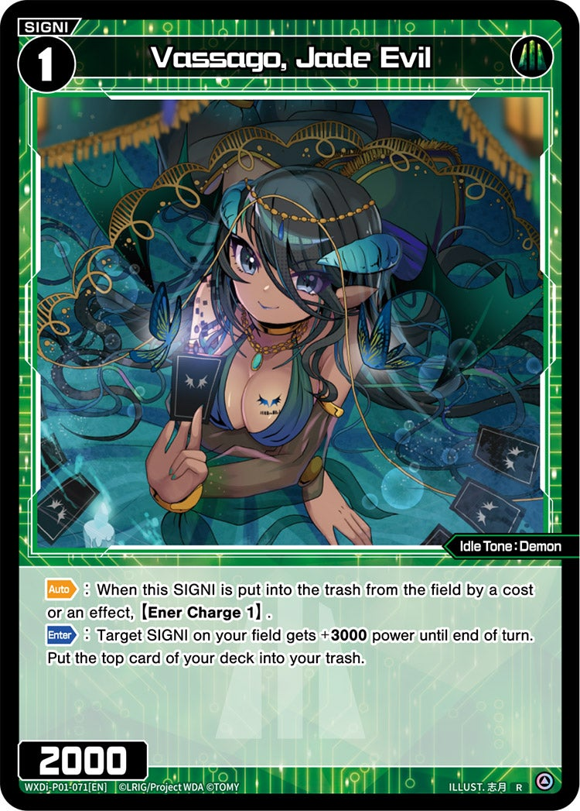

# Vassago, Jade Evil

## Thông tin lá

| Trường | Giá trị |
| --- | --- |
| Mã in | WXDi-P01-071[EN] |
| Set | WXDi-P01[EN] |
| Số thứ tự | 071 |
| Loại thẻ | SIGNI |
| Vị trí | Main Deck |
| Số bản | — (set booster, không áp dụng) |
| Màu | Xanh lá |
| Độ hiếm | R,R(P) |
| Minh họa | 志月 |
| Level | 1 |
| Limit | — |
| Power | 2000 |
| LRIG type / Class | Idol Tone：Demon |
| Team / Master | — |
| Cost | — |
| Grow cost | — |
| Use timing | — |
| Life Burst | Không |

## Card text chính thức

[Auto]: When this SIGNI is put into the trash from the field by a cost or an effect, 【Ener Charge 1】.
[Enter]: Target SIGNI on your field gets +3000 power until end of turn. Put the top card of your deck into your trash.

## Power text / Life Burst

—

## Ghi chú minh họa
Artist: 志月. Ảnh R được tải từ Card List tiếng Anh.

## FAQ chính thức

**Q. If I put this SIGNI on my trash due to exceeding the LRIG's limit, or if I put this SIGNI on my trash due to a remove (put any number of SIGNI on your field on your trash once in the main phase), will [Auto] be activated?**
A. No, you can't do either. The former is treated as a Rule-based action, the latter as a Main Phase action. Neither is a cost or an effect.

## Ảnh biến thể

- [R(P)](../images/WXDi-P01-071P-EN.jpg)

## Nguồn
[Card List/FAQ chính thức](https://www.takaratomy.co.jp/products/en.wixoss/card/card.html?card_no=WXDi-P01-071%5BEN%5D ) · [Ảnh thẻ](https://www.takaratomy.co.jp/products/en.wixoss/card/thumb/WXDi-P01-071%5BEN%5D.jpg)
