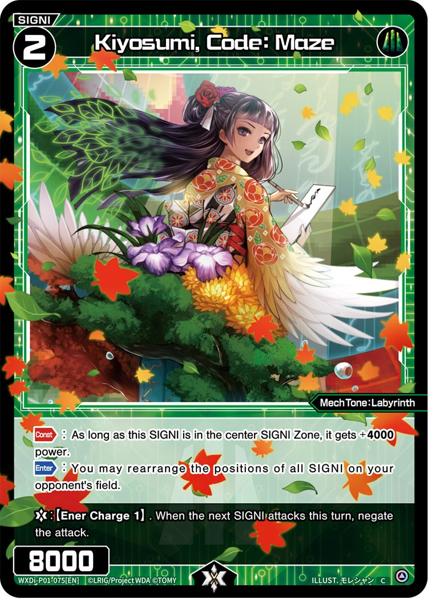

# Kiyosumi, Code: Maze

## Thông tin lá

| Trường | Giá trị |
| --- | --- |
| Mã in | WXDi-P01-075[EN] |
| Set | WXDi-P01[EN] |
| Số thứ tự | 075 |
| Loại thẻ | SIGNI |
| Vị trí | Main Deck |
| Số bản | — (set booster, không áp dụng) |
| Màu | Xanh lá |
| Độ hiếm | C,C(P) |
| Minh họa | モレシャン |
| Level | 2 |
| Limit | — |
| Power | 8000 |
| LRIG type / Class | Mech Tone：Labyrinth |
| Team / Master | — |
| Cost | — |
| Grow cost | — |
| Use timing | — |
| Life Burst | Có |

## Card text chính thức

[Constant]: As long as this SIGNI is in the center SIGNI Zone, it gets +4000 power.
[Enter]: You may rearrange the positions of all SIGNI on your opponent's field.

## Power text / Life Burst

【Ener Charge 1】. When the next SIGNI attacks this turn, negate the attack.

## Ghi chú minh họa
Artist: モレシャン. Ảnh C được tải từ Card List tiếng Anh.

## FAQ chính thức

**Q. When I activate [Enter], can I make the resulting placement the same as it was before I activated it?**
A. Yes, you can. [Enter] with no cost are forced to activate, but if the effect is to rearrange them as you wish, you can choose not to move them.

## Ảnh biến thể

- [C(P)](../images/WXDi-P01-075P-EN.jpg)

## Nguồn
[Card List/FAQ chính thức](https://www.takaratomy.co.jp/products/en.wixoss/card/card.html?card_no=WXDi-P01-075%5BEN%5D ) · [Ảnh thẻ](https://www.takaratomy.co.jp/products/en.wixoss/card/thumb/WXDi-P01-075%5BEN%5D.jpg)
