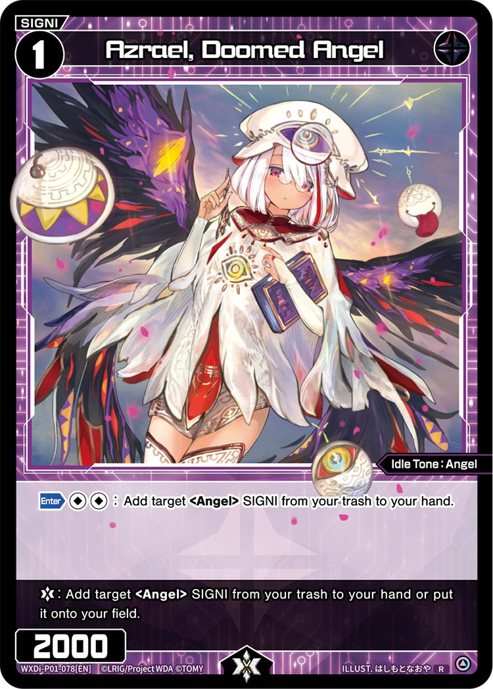

# Azrael, Doomed Angel

## Thông tin lá

| Trường | Giá trị |
| --- | --- |
| Mã in | WXDi-P01-078[EN] |
| Set | WXDi-P01[EN] |
| Số thứ tự | 078 |
| Loại thẻ | SIGNI |
| Vị trí | Main Deck |
| Số bản | — (set booster, không áp dụng) |
| Màu | Đen |
| Độ hiếm | R,R(P) |
| Minh họa | はしもとなおや |
| Level | 1 |
| Limit | — |
| Power | 2000 |
| LRIG type / Class | Idol Tone：Angel |
| Team / Master | — |
| Cost | — |
| Grow cost | — |
| Use timing | — |
| Life Burst | Có |

## Card text chính thức

[Enter] {Colorless} {Colorless}: Add target <Angel> SIGNI from your trash to your hand.

## Power text / Life Burst

Add target <Angel> SIGNI from your trash to your hand or put it onto your field.

## Ghi chú minh họa
Artist: はしもとなおや. Ảnh R được tải từ Card List tiếng Anh.

## FAQ chính thức

**Q. Can I add a card I paid as Ener Cost of  [Enter] to my hand by its effect?**
A. Yes, you can. You pay the cost and then target it, so if it is a SIGNI that meets the condition, it will be targeted and added to your hand.

## Ảnh biến thể

- [R(P)](../images/WXDi-P01-078P-EN.jpg)

## Nguồn
[Card List/FAQ chính thức](https://www.takaratomy.co.jp/products/en.wixoss/card/card.html?card_no=WXDi-P01-078%5BEN%5D ) · [Ảnh thẻ](https://www.takaratomy.co.jp/products/en.wixoss/card/thumb/WXDi-P01-078%5BEN%5D.jpg)
