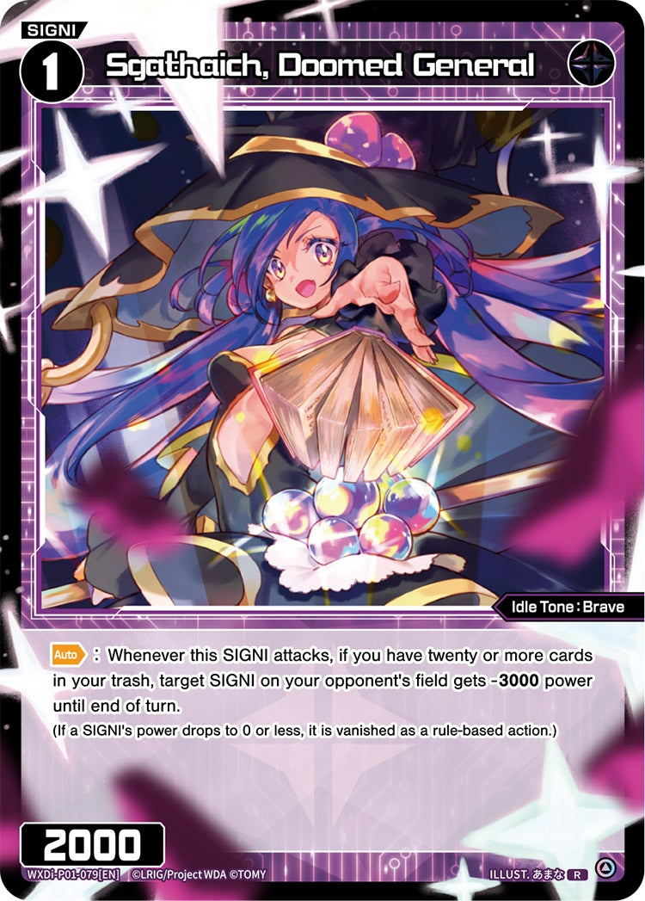

# Sgathaich, Doomed General

## Thông tin lá

| Trường | Giá trị |
| --- | --- |
| Mã in | WXDi-P01-079[EN] |
| Set | WXDi-P01[EN] |
| Số thứ tự | 079 |
| Loại thẻ | SIGNI |
| Vị trí | Main Deck |
| Số bản | — (set booster, không áp dụng) |
| Màu | Đen |
| Độ hiếm | R,R(P) |
| Minh họa | あまな |
| Level | 1 |
| Limit | — |
| Power | 2000 |
| LRIG type / Class | Idol Tone：Brave |
| Team / Master | — |
| Cost | — |
| Grow cost | — |
| Use timing | — |
| Life Burst | Không |

## Card text chính thức

[Auto]: Whenever this SIGNI attacks, if you have twenty or more cards in your trash, target SIGNI on your opponent's field gets -3000 power until end of turn.
(If a SIGNI's power drops to 0 or less, it is vanished as a rule-based action.)

## Power text / Life Burst

—

## Ghi chú minh họa
Artist: あまな. Ảnh R được tải từ Card List tiếng Anh.

## FAQ chính thức

— (không có FAQ riêng cho mã này trên trang FAQ tiếng Anh.)

## Ảnh biến thể

- [R(P)](../images/WXDi-P01-079P-EN.jpg)

## Nguồn
[Card List/FAQ chính thức](https://www.takaratomy.co.jp/products/en.wixoss/card/card.html?card_no=WXDi-P01-079%5BEN%5D ) · [Ảnh thẻ](https://www.takaratomy.co.jp/products/en.wixoss/card/thumb/WXDi-P01-079%5BEN%5D.jpg)
