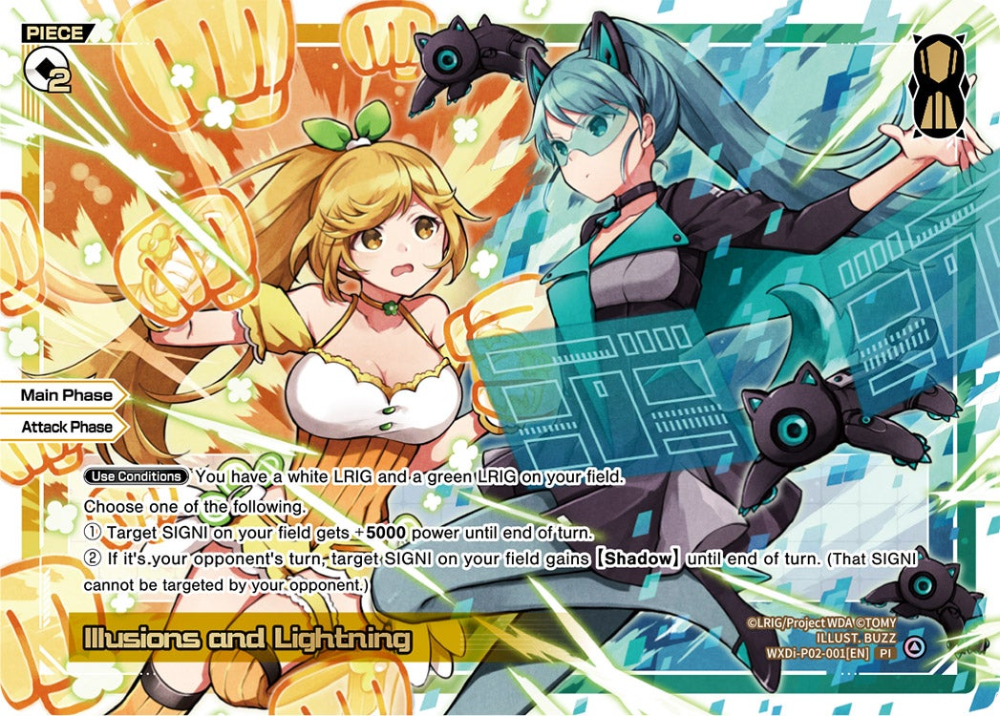

# Illusions and Lightning

## Thông tin lá

| Trường | Giá trị |
| --- | --- |
| Mã in | WXDi-P02-001[EN] |
| Set | WXDi-P02[EN] |
| Số thứ tự | 001 |
| Loại thẻ | PIECE |
| Vị trí | LRIG Deck |
| Số bản | — (set booster, không áp dụng) |
| Màu | Trắng / xanh lá |
| Độ hiếm | PI |
| Minh họa | BUZZ |
| Level | — |
| Limit | — |
| Power | 0 |
| LRIG type / Class | — |
| Team / Master | — |
| Cost | 《C》×２ |
| Grow cost | — |
| Use timing | Main Phase
Attack Phase |
| Life Burst | Không |

## Card text chính thức

[Use Conditions] You have a white LRIG and a green LRIG on your field.

Choose one of the following.
① Target SIGNI on your field gets +5000 power until end of turn.
② If it's your opponent's turn, target SIGNI on your field gains 【Shadow】 until end of turn. (That SIGNI cannot be targeted by your opponent.)

## Power text / Life Burst

—

## Ghi chú minh họa
Artist: BUZZ. Ảnh PI được tải từ Card List tiếng Anh.

## FAQ chính thức

**Q. Can this card's latter ability protect it from <P01-040 Robin Hood, Jade General Queen>'s effect?**
A. No, you can't. [Shadow] is an effect that restricts target selection, so it does not protect from effects that do not select targets, such as "put all SIGNI on your opponent's field into their Ener Zone."

## Nguồn
[Card List/FAQ chính thức](https://www.takaratomy.co.jp/products/en.wixoss/card/card.html?card_no=WXDi-P02-001%5BEN%5D ) · [Ảnh thẻ](https://www.takaratomy.co.jp/products/en.wixoss/card/thumb/WXDi-P02-001%5BEN%5D.jpg)
