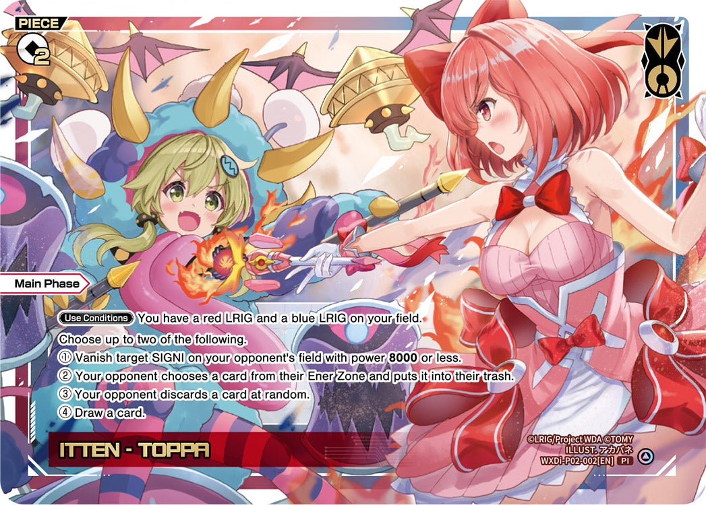

# ITTEN - TOPPA

## Thông tin lá

| Trường | Giá trị |
| --- | --- |
| Mã in | WXDi-P02-002[EN] |
| Set | WXDi-P02[EN] |
| Số thứ tự | 002 |
| Loại thẻ | PIECE |
| Vị trí | LRIG Deck |
| Số bản | — (set booster, không áp dụng) |
| Màu | Đỏ / xanh dương |
| Độ hiếm | PI |
| Minh họa | アカバネ |
| Level | — |
| Limit | — |
| Power | 0 |
| LRIG type / Class | — |
| Team / Master | — |
| Cost | 《C》×２ |
| Grow cost | — |
| Use timing | Main Phase |
| Life Burst | Không |

## Card text chính thức

[Use Conditions] You have a red LRIG and a blue LRIG on your field.

Choose up to two of the following.
① Vanish target SIGNI on your opponent's field with power 8000 or less.
② Your opponent chooses a card from their Ener Zone and puts it into their trash.
③ Your opponent discards a card at random.
④ Draw a card.

## Power text / Life Burst

—

## Ghi chú minh họa
Artist: アカバネ. Ảnh PI được tải từ Card List tiếng Anh.

## FAQ chính thức

**Q. If the effect of ① and ② is selected while the opponent's Ener Zone is 0.**
A. In this case, after vanishing SIGNI in ①, the opponent chooses that card in the Ener Zone.

**Q. After drawing a card by the effect of ④, can you choose another Mode from ① to ③?**
A. No, you can't. You have to choose two Modes at the same time. Also, the effects are processed in order from the top, so the effect ④ cannot be processed first.

## Nguồn
[Card List/FAQ chính thức](https://www.takaratomy.co.jp/products/en.wixoss/card/card.html?card_no=WXDi-P02-002%5BEN%5D ) · [Ảnh thẻ](https://www.takaratomy.co.jp/products/en.wixoss/card/thumb/WXDi-P02-002%5BEN%5D.jpg)
