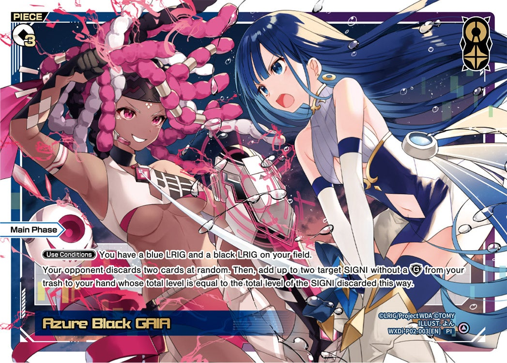

# Azure Black GAIA

## Thông tin lá

| Trường | Giá trị |
| --- | --- |
| Mã in | WXDi-P02-003[EN] |
| Set | WXDi-P02[EN] |
| Số thứ tự | 003 |
| Loại thẻ | PIECE |
| Vị trí | LRIG Deck |
| Số bản | — (set booster, không áp dụng) |
| Màu | Xanh dương / đen |
| Độ hiếm | PI |
| Minh họa | よん |
| Level | — |
| Limit | — |
| Power | 0 |
| LRIG type / Class | — |
| Team / Master | — |
| Cost | 《C》×３ |
| Grow cost | — |
| Use timing | Main Phase |
| Life Burst | Không |

## Card text chính thức

[Use Conditions] You have a blue LRIG and a black LRIG on your field.

Your opponent discards two cards at random. Then, add up to two target SIGNI without a {Guard Icon} from your trash to your hand whose total level is equal to the total level of the SIGNI discarded this way.

## Power text / Life Burst

—

## Ghi chú minh họa
Artist: よん. Ảnh PI được tải từ Card List tiếng Anh.

## FAQ chính thức

**Q. If both cards discarded are spells.
In this case, it cannot be added to your hand because there is no level value to refer to in the latter effect. If one of the two cards is SIGNI card, you can add up to two SIGNI cards from your trash to your hand by referring to the level value of that one card.**
A. In this case, it cannot be added to your hand because there is no level value to refer to in the latter effect. If one of the two cards is SIGNI card, you can add up to two SIGNI cards from your trash to your hand by referring to the level value of that one card.

**Q. If I use it when my opponent has 0 or 1 card in hand.**
A. If 0, the SIGNI cannot be salvaged by the latter effect.
If 1 card, refers to the discarded card. If it is a SIGNI, you can salvage up to 2 cards with reference to its level value.

## Nguồn
[Card List/FAQ chính thức](https://www.takaratomy.co.jp/products/en.wixoss/card/card.html?card_no=WXDi-P02-003%5BEN%5D ) · [Ảnh thẻ](https://www.takaratomy.co.jp/products/en.wixoss/card/thumb/WXDi-P02-003%5BEN%5D.jpg)
