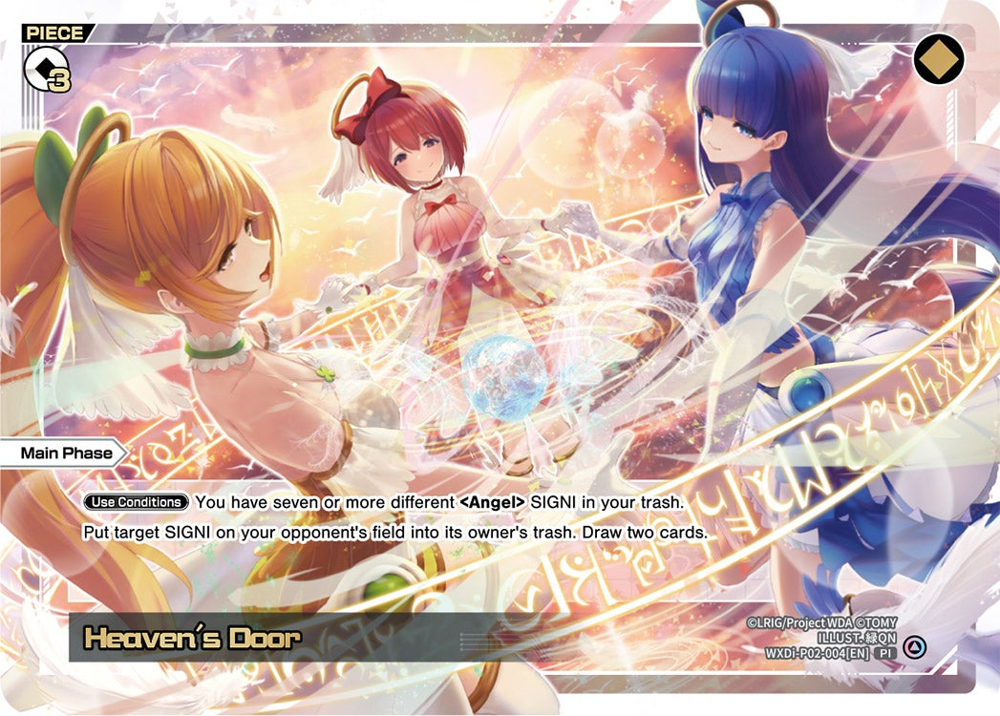

# Heaven's Door

## Thông tin lá

| Trường | Giá trị |
| --- | --- |
| Mã in | WXDi-P02-004[EN] |
| Set | WXDi-P02[EN] |
| Số thứ tự | 004 |
| Loại thẻ | PIECE |
| Vị trí | LRIG Deck |
| Số bản | — (set booster, không áp dụng) |
| Màu | Không màu |
| Độ hiếm | PI |
| Minh họa | 緑QN |
| Level | — |
| Limit | — |
| Power | 0 |
| LRIG type / Class | — |
| Team / Master | — |
| Cost | 《C》×３ |
| Grow cost | — |
| Use timing | Main Phase |
| Life Burst | Không |

## Card text chính thức

[Use Conditions] You have seven or more different <Angel> SIGNI in your trash.

Put target SIGNI on your opponent's field into its owner's trash. Draw two cards.

## Power text / Life Burst

—

## Ghi chú minh họa
Artist: 緑QN. Ảnh PI được tải từ Card List tiếng Anh.

## FAQ chính thức

**Q. If I use it when my opponent's SIGNI is not on the field**
A. Yes, you can draw. This card can be used even if there is no legal target on the opponent's field. Also, as a result of using the card, you can draw two cards regardless of whether or not your opponent's SIGNI is placed in the trash.

## Nguồn
[Card List/FAQ chính thức](https://www.takaratomy.co.jp/products/en.wixoss/card/card.html?card_no=WXDi-P02-004%5BEN%5D ) · [Ảnh thẻ](https://www.takaratomy.co.jp/products/en.wixoss/card/thumb/WXDi-P02-004%5BEN%5D.jpg)
