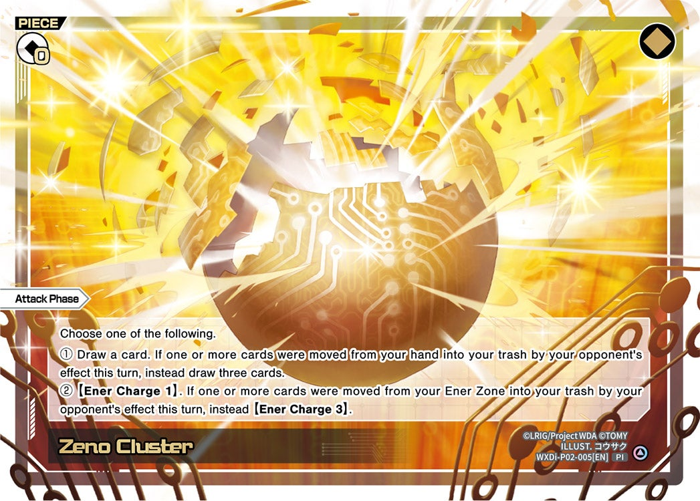

# Zeno Cluster

## Thông tin lá

| Trường | Giá trị |
| --- | --- |
| Mã in | WXDi-P02-005[EN] |
| Set | WXDi-P02[EN] |
| Số thứ tự | 005 |
| Loại thẻ | PIECE |
| Vị trí | LRIG Deck |
| Số bản | — (set booster, không áp dụng) |
| Màu | Không màu |
| Độ hiếm | PI |
| Minh họa | コウサク |
| Level | — |
| Limit | — |
| Power | 0 |
| LRIG type / Class | — |
| Team / Master | — |
| Cost | 《C》×０ |
| Grow cost | — |
| Use timing | Attack Phase |
| Life Burst | Không |

## Card text chính thức

Choose one of the following.
① Draw a card. If one or more cards were moved from your hand into your trash by your opponent's effect this turn, instead draw three cards.
② 【Ener Charge 1】. If one or more cards were moved from your Ener Zone into your trash by your opponent's effect this turn, instead 【Ener Charge 3】.

## Power text / Life Burst

—

## Ghi chú minh họa
Artist: コウサク. Ảnh PI được tải từ Card List tiếng Anh.

## FAQ chính thức

**Q. My opponent used "Go to the TOP!", And I chose 3 cards from my Ener Zone and put them into my Trash. Can I use the effect of ② to [Ener Charge3] in the Attack Phase of that turn?**
A. Yes, you can, even if you chose to move a card from the Ener Zone to the Trash, it is your opponent's effect that moved it, thus fulfilling condition  of ② and allowing you to [Ener Charge3].

## Nguồn
[Card List/FAQ chính thức](https://www.takaratomy.co.jp/products/en.wixoss/card/card.html?card_no=WXDi-P02-005%5BEN%5D ) · [Ảnh thẻ](https://www.takaratomy.co.jp/products/en.wixoss/card/thumb/WXDi-P02-005%5BEN%5D.jpg)
