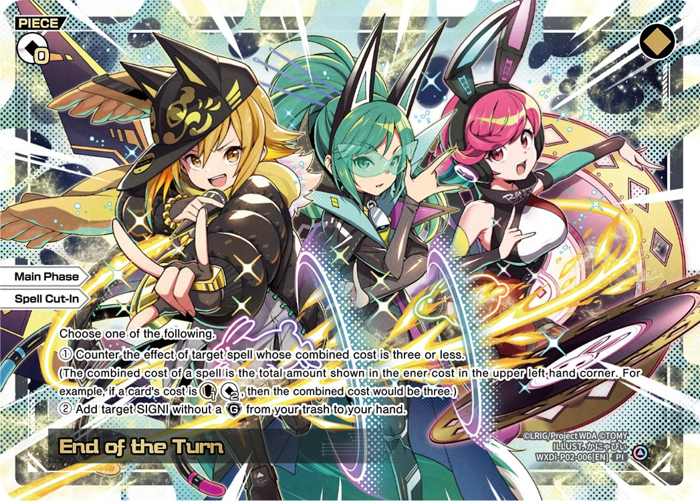

# End of the Turn

## Thông tin lá

| Trường | Giá trị |
| --- | --- |
| Mã in | WXDi-P02-006[EN] |
| Set | WXDi-P02[EN] |
| Số thứ tự | 006 |
| Loại thẻ | PIECE |
| Vị trí | LRIG Deck |
| Số bản | — (set booster, không áp dụng) |
| Màu | Không màu |
| Độ hiếm | PI |
| Minh họa | かにゃぴぃ |
| Level | — |
| Limit | — |
| Power | 0 |
| LRIG type / Class | — |
| Team / Master | — |
| Cost | 《C》×０ |
| Grow cost | — |
| Use timing | Main Phase
Spell Cut-In |
| Life Burst | Không |

## Card text chính thức

Choose one of the following.
① Counter the effect of target spell whose combined cost is three or less.
(The combined cost of a spell is the total amount shown in the ener cost in the upper left hand corner. For example, if a card's cost is {Whitex1} {Colorlessx2}, then the combined cost would be three.)
② Add target SIGNI without a {Guard Icon} from your trash to your hand.

## Power text / Life Burst

—

## Ghi chú minh họa
Artist: かにゃぴぃ. Ảnh PI được tải từ Card List tiếng Anh.

## FAQ chính thức

**Q. "Counter the effect of target spell"とは？**
A. Countered spells are placed in the trash without any effect. All costs paid to use the Spell are not returned.

**Q. When the opponent's spell's Life Burst is triggered, can it be canceled by the effect of ① on this Piece?**
A. No, this card cannot be used in response to a Life Burst's trigger.

## Nguồn
[Card List/FAQ chính thức](https://www.takaratomy.co.jp/products/en.wixoss/card/card.html?card_no=WXDi-P02-006%5BEN%5D ) · [Ảnh thẻ](https://www.takaratomy.co.jp/products/en.wixoss/card/thumb/WXDi-P02-006%5BEN%5D.jpg)
