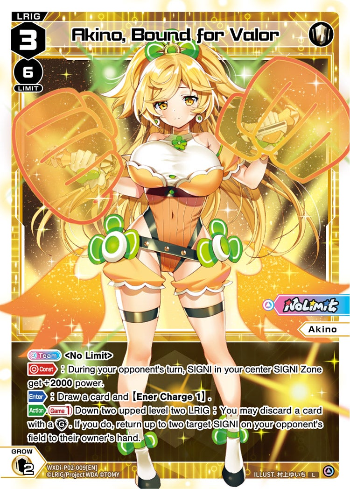

# Akino, Bound for Valor

## Thông tin lá

| Trường | Giá trị |
| --- | --- |
| Mã in | WXDi-P02-009[EN] |
| Set | WXDi-P02[EN] |
| Số thứ tự | 009 |
| Loại thẻ | LRIG |
| Vị trí | LRIG Deck |
| Số bản | — (set booster, không áp dụng) |
| Màu | Trắng |
| Độ hiếm | L,SCR,DiR |
| Minh họa | 村上ゆいち |
| Level | 3 |
| Limit | 6 |
| Power | 0 |
| LRIG type / Class | Akino |
| Team / Master | No Limit |
| Cost | — |
| Grow cost | 《W》×２ |
| Use timing | — |
| Life Burst | Không |

## Card text chính thức

[Team] <No Limit>
[Team Constant]: During your opponent's turn, SIGNI in your center SIGNI Zone get +2000 power.
[Enter]: Draw a card and 【Ener Charge 1】.
[Action] {1/Game} Down two upped level two LRIG: You may discard a card with a {Guard Icon}. If you do, return up to two target SIGNI on your opponent's field to their owner's hand.

## Power text / Life Burst

—

## Ghi chú minh họa
Artist: 村上ゆいち. Ảnh L được tải từ Card List tiếng Anh.

## FAQ chính thức

— (không có FAQ riêng cho mã này trên trang FAQ tiếng Anh.)

## Ảnh biến thể

- [DiR](../images/WXDi-P02-009D-EN.jpg)
- [SCR](../images/WXDi-P02-009S-EN.jpg)

## Nguồn
[Card List/FAQ chính thức](https://www.takaratomy.co.jp/products/en.wixoss/card/card.html?card_no=WXDi-P02-009%5BEN%5D ) · [Ảnh thẻ](https://www.takaratomy.co.jp/products/en.wixoss/card/thumb/WXDi-P02-009%5BEN%5D.jpg)
