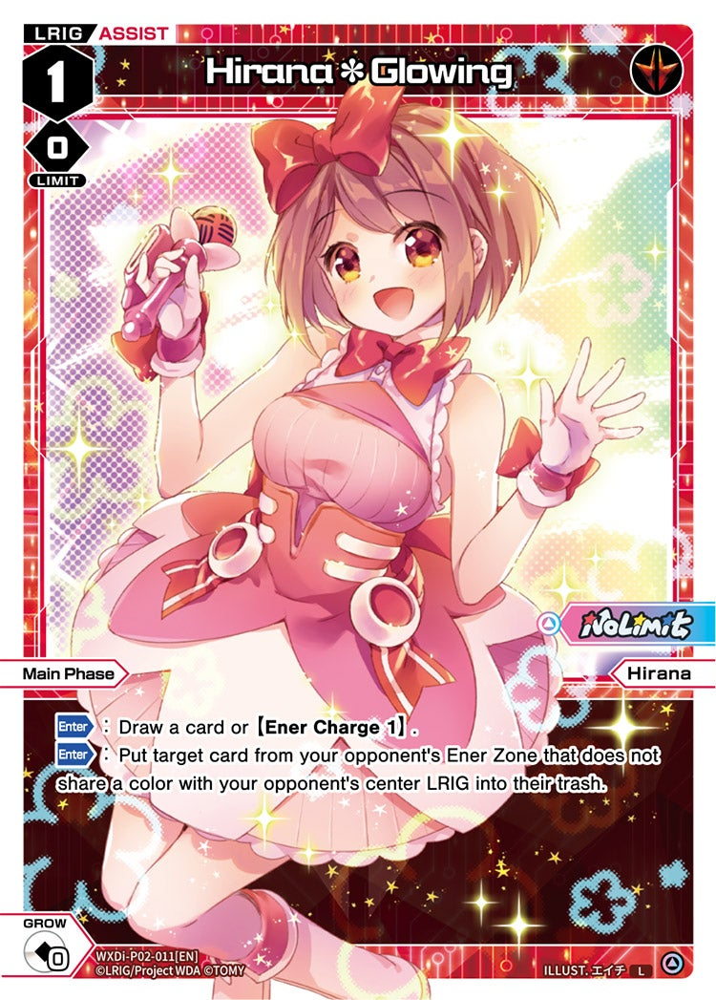

# Hirana*Glowing

## Thông tin lá

| Trường | Giá trị |
| --- | --- |
| Mã in | WXDi-P02-011[EN] |
| Set | WXDi-P02[EN] |
| Số thứ tự | 011 |
| Loại thẻ | ASSIST LRIG |
| Vị trí | LRIG Deck |
| Số bản | — (set booster, không áp dụng) |
| Màu | Đỏ |
| Độ hiếm | L,L(P) |
| Minh họa | エイチ |
| Level | 1 |
| Limit | 0 |
| Power | 0 |
| LRIG type / Class | Hirana |
| Team / Master | No Limit |
| Cost | — |
| Grow cost | 《C》×０ |
| Use timing | Main Phase |
| Life Burst | Không |

## Card text chính thức

[Enter]: Draw a card or 【Ener Charge 1】.
[Enter]: Put target card from your opponent's Ener Zone that does not share a color with your opponent's center LRIG into their trash.

## Power text / Life Burst

—

## Ghi chú minh họa
Artist: エイチ. Ảnh L được tải từ Card List tiếng Anh.

## FAQ chính thức

**Q. Can I target opponent's "Servant #" with the Enter ability?**
A. Yes, "Servant #" is a colorless card, so it has no color in common with any color LRIG and is a legal target for this ability.

## Ảnh biến thể

- [L(P)](../images/WXDi-P02-011P-EN.jpg)

## Nguồn
[Card List/FAQ chính thức](https://www.takaratomy.co.jp/products/en.wixoss/card/card.html?card_no=WXDi-P02-011%5BEN%5D ) · [Ảnh thẻ](https://www.takaratomy.co.jp/products/en.wixoss/card/thumb/WXDi-P02-011%5BEN%5D.jpg)
