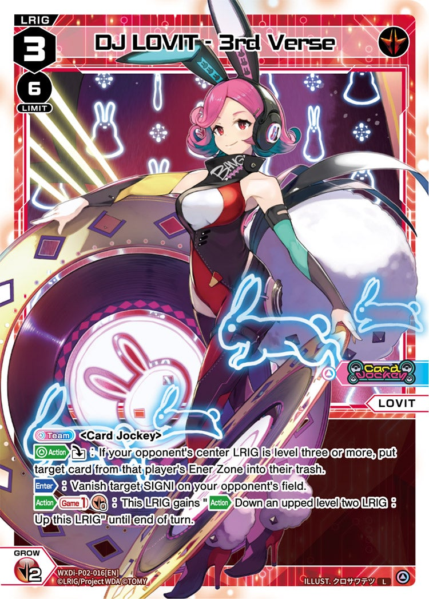

# DJ LOVIT - 3rd Verse

## Thông tin lá

| Trường | Giá trị |
| --- | --- |
| Mã in | WXDi-P02-016[EN] |
| Set | WXDi-P02[EN] |
| Số thứ tự | 016 |
| Loại thẻ | LRIG |
| Vị trí | LRIG Deck |
| Số bản | — (set booster, không áp dụng) |
| Màu | Đỏ |
| Độ hiếm | L,SCR,DiR |
| Minh họa | クロサワテツ |
| Level | 3 |
| Limit | 6 |
| Power | 0 |
| LRIG type / Class | LOVIT |
| Team / Master | Card Jockey |
| Cost | — |
| Grow cost | 《R》×２ |
| Use timing | — |
| Life Burst | Không |

## Card text chính thức

[Team] <Card Jockey>
[Team Action] {Down}: If your opponent's center LRIG is level three or more, put target card from that player's Ener Zone into their trash.
[Enter]: Vanish target SIGNI on your opponent's field.
[Action] {1/Game} {Redx0}: This LRIG gains "[Action] Down an upped level two LRIG: Up this LRIG" until end of turn.

## Power text / Life Burst

—

## Ghi chú minh họa
Artist: クロサワテツ. Ảnh L được tải từ Card List tiếng Anh.

## FAQ chính thức

— (không có FAQ riêng cho mã này trên trang FAQ tiếng Anh.)

## Ảnh biến thể

- [DiR](../images/WXDi-P02-016D-EN.jpg)
- [SCR](../images/WXDi-P02-016S-EN.jpg)

## Nguồn
[Card List/FAQ chính thức](https://www.takaratomy.co.jp/products/en.wixoss/card/card.html?card_no=WXDi-P02-016%5BEN%5D ) · [Ảnh thẻ](https://www.takaratomy.co.jp/products/en.wixoss/card/thumb/WXDi-P02-016%5BEN%5D.jpg)
