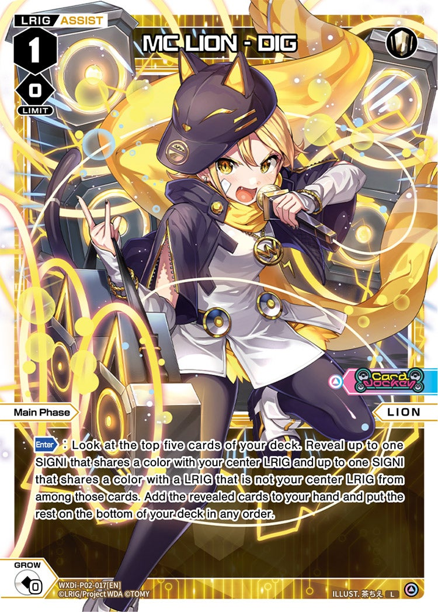

# MC LION - DIG

## Thông tin lá

| Trường | Giá trị |
| --- | --- |
| Mã in | WXDi-P02-017[EN] |
| Set | WXDi-P02[EN] |
| Số thứ tự | 017 |
| Loại thẻ | ASSIST LRIG |
| Vị trí | LRIG Deck |
| Số bản | — (set booster, không áp dụng) |
| Màu | Trắng |
| Độ hiếm | L,L(P) |
| Minh họa | 茶ちえ |
| Level | 1 |
| Limit | 0 |
| Power | 0 |
| LRIG type / Class | LION |
| Team / Master | Card Jockey |
| Cost | — |
| Grow cost | 《C》×０ |
| Use timing | Main Phase |
| Life Burst | Không |

## Card text chính thức

[Enter]: Look at the top five cards of your deck. Reveal up to one SIGNI that shares a color with your center LRIG and up to one SIGNI that shares a color with a LRIG that is not your center LRIG from among those cards. Add the revealed cards to your hand and put the rest on the bottom of your deck in any order.

## Power text / Life Burst

—

## Ghi chú minh họa
Artist: 茶ちえ. Ảnh L được tải từ Card List tiếng Anh.

## FAQ chính thức

— (không có FAQ riêng cho mã này trên trang FAQ tiếng Anh.)

## Ảnh biến thể

- [L(P)](../images/WXDi-P02-017P-EN.jpg)

## Nguồn
[Card List/FAQ chính thức](https://www.takaratomy.co.jp/products/en.wixoss/card/card.html?card_no=WXDi-P02-017%5BEN%5D ) · [Ảnh thẻ](https://www.takaratomy.co.jp/products/en.wixoss/card/thumb/WXDi-P02-017%5BEN%5D.jpg)
