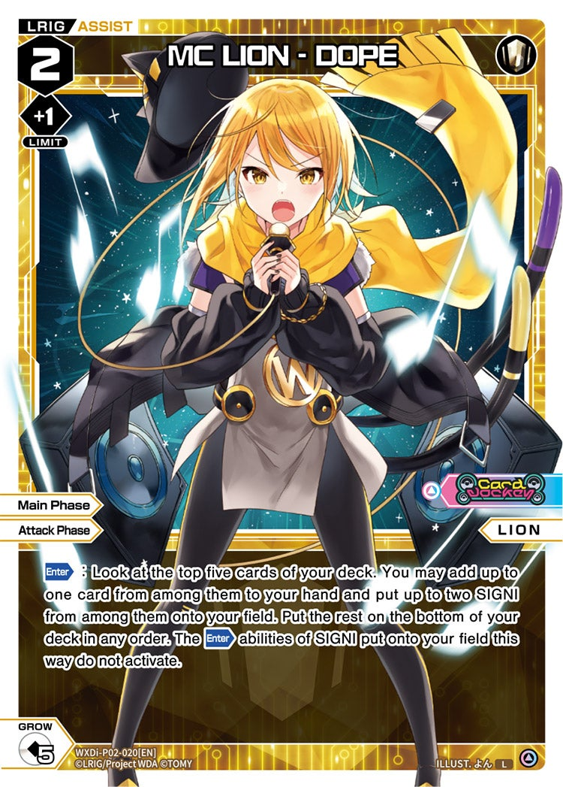

# MC LION - DOPE

## Thông tin lá

| Trường | Giá trị |
| --- | --- |
| Mã in | WXDi-P02-020[EN] |
| Set | WXDi-P02[EN] |
| Số thứ tự | 020 |
| Loại thẻ | ASSIST LRIG |
| Vị trí | LRIG Deck |
| Số bản | — (set booster, không áp dụng) |
| Màu | Trắng |
| Độ hiếm | L,L(P) |
| Minh họa | よん |
| Level | 2 |
| Limit | ＋１ |
| Power | 0 |
| LRIG type / Class | LION |
| Team / Master | Card Jockey |
| Cost | — |
| Grow cost | 《C》×５ |
| Use timing | Main Phase / Attack Phase |
| Life Burst | Không |

## Card text chính thức

[Enter]: Look at the top five cards of your deck. You may add up to one card from among them to your hand and put up to two SIGNI from among them onto your field. Put the rest on the bottom of your deck in any order. The [Enter] abilities of SIGNI put onto your field this way do not activate.

## Power text / Life Burst

—

## Ghi chú minh họa
Artist: よん. Ảnh L được tải từ Card List tiếng Anh.

## FAQ chính thức

— (không có FAQ riêng cho mã này trên trang FAQ tiếng Anh.)

## Ảnh biến thể

- [L(P)](../images/WXDi-P02-020P-EN.jpg)

## Nguồn
[Card List/FAQ chính thức](https://www.takaratomy.co.jp/products/en.wixoss/card/card.html?card_no=WXDi-P02-020%5BEN%5D ) · [Ảnh thẻ](https://www.takaratomy.co.jp/products/en.wixoss/card/thumb/WXDi-P02-020%5BEN%5D.jpg)
