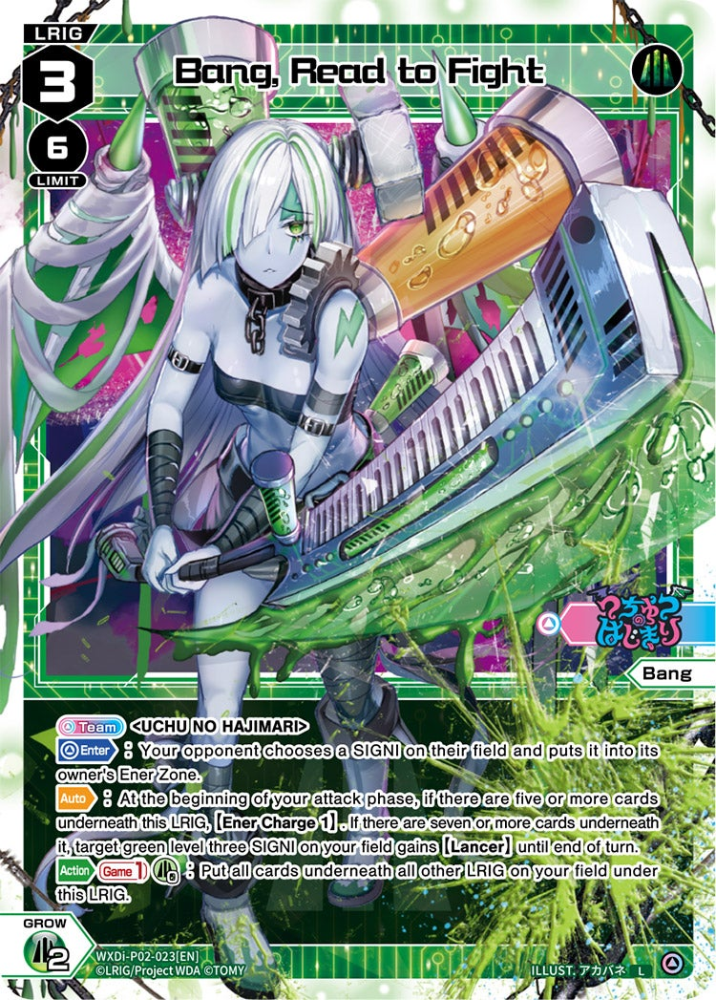

# Bang, Read to Fight

## Thông tin lá

| Trường | Giá trị |
| --- | --- |
| Mã in | WXDi-P02-023[EN] |
| Set | WXDi-P02[EN] |
| Số thứ tự | 023 |
| Loại thẻ | LRIG |
| Vị trí | LRIG Deck |
| Số bản | — (set booster, không áp dụng) |
| Màu | Xanh lá |
| Độ hiếm | L,SCR,DiR |
| Minh họa | アカバネ |
| Level | 3 |
| Limit | 6 |
| Power | 0 |
| LRIG type / Class | Bang |
| Team / Master | UCHU NO HAJIMARI |
| Cost | — |
| Grow cost | 《G》×２ |
| Use timing | — |
| Life Burst | Không |

## Card text chính thức

[Team] <UCHU NO HAJIMARI>
[Team Enter]: Your opponent chooses a SIGNI on their field and puts it into its owner's Ener Zone.
[Auto]: At the beginning of your attack phase, if there are five or more cards underneath this LRIG, 【Ener Charge 1】. If there are seven or more cards underneath it, target green level three SIGNI on your field gains 【Lancer】 until end of turn.
[Action] {1/Game} {Greenx0}: Put all cards underneath all other LRIG on your field under this LRIG.

## Power text / Life Burst

—

## Ghi chú minh họa
Artist: アカバネ. Ảnh L được tải từ Card List tiếng Anh.

## FAQ chính thức

**Q. Regarding [Team Enter]. Can the opponent also choose SIGNI placed in hand or trash?**
A. No, cannot choose. Unless otherwise specified, the effect of selecting SIGNI is selected only from SIGNI on the field.

**Q. If there are more than 7 cards under this LRIG, can I do both "[Ener Charge 1]" and "target green level three SIGNI on your field gains [Lancer]"?**
A. Yes, you can do both.

## Ảnh biến thể

- [DiR](../images/WXDi-P02-023D-EN.jpg)
- [SCR](../images/WXDi-P02-023S-EN.jpg)

## Nguồn
[Card List/FAQ chính thức](https://www.takaratomy.co.jp/products/en.wixoss/card/card.html?card_no=WXDi-P02-023%5BEN%5D ) · [Ảnh thẻ](https://www.takaratomy.co.jp/products/en.wixoss/card/thumb/WXDi-P02-023%5BEN%5D.jpg)
