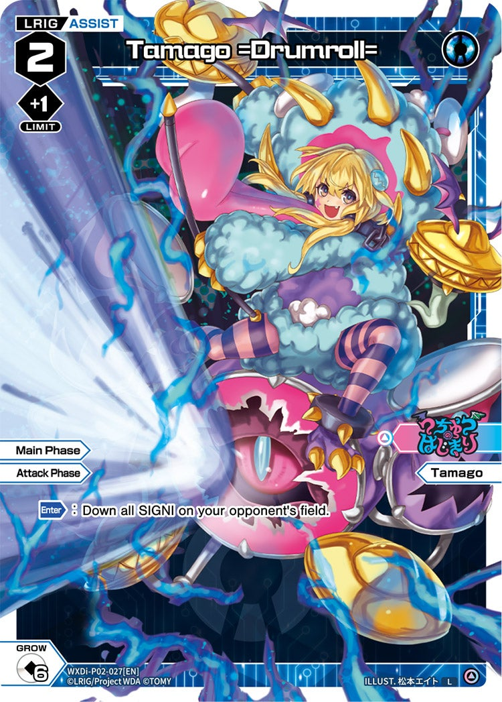

# Tamago =Drumroll=

## Thông tin lá

| Trường | Giá trị |
| --- | --- |
| Mã in | WXDi-P02-027[EN] |
| Set | WXDi-P02[EN] |
| Số thứ tự | 027 |
| Loại thẻ | ASSIST LRIG |
| Vị trí | LRIG Deck |
| Số bản | — (set booster, không áp dụng) |
| Màu | Xanh dương |
| Độ hiếm | L,L(P) |
| Minh họa | 松本エイト |
| Level | 2 |
| Limit | ＋１ |
| Power | 0 |
| LRIG type / Class | Tamago |
| Team / Master | UCHU NO HAJIMARI |
| Cost | — |
| Grow cost | 《C》×６ |
| Use timing | Main Phase
Attack Phase |
| Life Burst | Không |

## Card text chính thức

[Enter]: Down all SIGNI on your opponent's field.

## Power text / Life Burst

—

## Ghi chú minh họa
Artist: 松本エイト. Ảnh L được tải từ Card List tiếng Anh.

## FAQ chính thức

**Q. Can SIGNI with [shadow] also be downed by this effect?**
A. Yes, it goes downed. SIGNI with [shadow] is no longer targeted by opponent effects, but this ability does not require targeting.

## Ảnh biến thể

- [L(P)](../images/WXDi-P02-027P-EN.jpg)

## Nguồn
[Card List/FAQ chính thức](https://www.takaratomy.co.jp/products/en.wixoss/card/card.html?card_no=WXDi-P02-027%5BEN%5D ) · [Ảnh thẻ](https://www.takaratomy.co.jp/products/en.wixoss/card/thumb/WXDi-P02-027%5BEN%5D.jpg)
