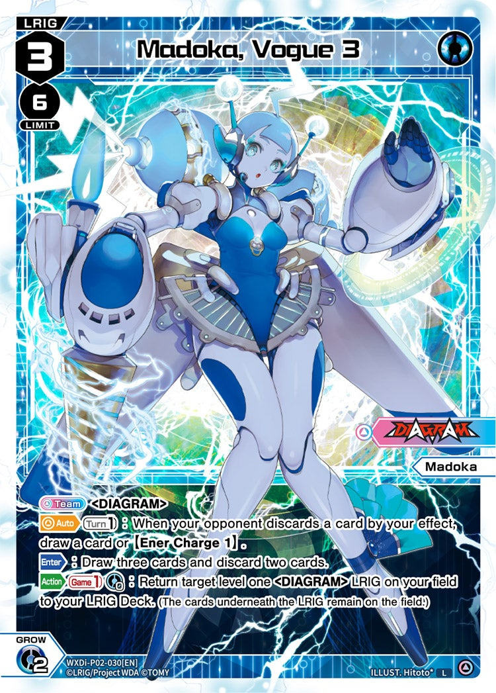

# Madoka, Vogue 3

## Thông tin lá

| Trường | Giá trị |
| --- | --- |
| Mã in | WXDi-P02-030[EN] |
| Set | WXDi-P02[EN] |
| Số thứ tự | 030 |
| Loại thẻ | LRIG |
| Vị trí | LRIG Deck |
| Số bản | — (set booster, không áp dụng) |
| Màu | Xanh dương |
| Độ hiếm | L,SCR,DiR |
| Minh họa | Hitoto* |
| Level | 3 |
| Limit | 6 |
| Power | 0 |
| LRIG type / Class | Madoka |
| Team / Master | DIAGRAM |
| Cost | — |
| Grow cost | 《U》×２ |
| Use timing | — |
| Life Burst | Không |

## Card text chính thức

[Team] <DIAGRAM>
[Team Auto] {1/Turn}: When your opponent discards a card by your effect, draw a card or 【Ener Charge 1】.
[Enter]: Draw three cards and discard two cards.
[Action] {1/Game} {Bluex0}: Return target level one <DIAGRAM> LRIG on your field to your LRIG Deck. (The cards underneath the LRIG remain on the field.)

## Power text / Life Burst

—

## Ghi chú minh họa
Artist: Hitoto*. Ảnh L được tải từ Card List tiếng Anh.

## FAQ chính thức

— (không có FAQ riêng cho mã này trên trang FAQ tiếng Anh.)

## Ảnh biến thể

- [DiR](../images/WXDi-P02-030D-EN.jpg)
- [SCR](../images/WXDi-P02-030S-EN.jpg)

## Nguồn
[Card List/FAQ chính thức](https://www.takaratomy.co.jp/products/en.wixoss/card/card.html?card_no=WXDi-P02-030%5BEN%5D ) · [Ảnh thẻ](https://www.takaratomy.co.jp/products/en.wixoss/card/thumb/WXDi-P02-030%5BEN%5D.jpg)
