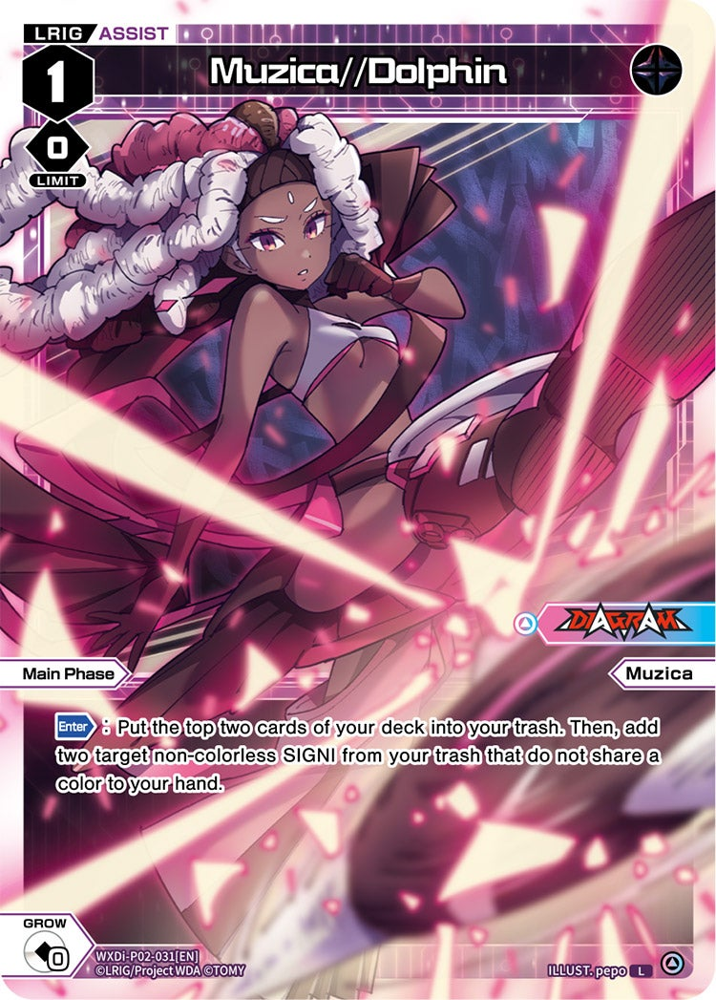

# Muzica//Dolphin

## Thông tin lá

| Trường | Giá trị |
| --- | --- |
| Mã in | WXDi-P02-031[EN] |
| Set | WXDi-P02[EN] |
| Số thứ tự | 031 |
| Loại thẻ | ASSIST LRIG |
| Vị trí | LRIG Deck |
| Số bản | — (set booster, không áp dụng) |
| Màu | Đen |
| Độ hiếm | L,L(P) |
| Minh họa | pepo |
| Level | 1 |
| Limit | 0 |
| Power | 0 |
| LRIG type / Class | Muzica |
| Team / Master | DIAGRAM |
| Cost | — |
| Grow cost | 《C》×０ |
| Use timing | Main Phase |
| Life Burst | Không |

## Card text chính thức

[Enter]: Put the top two cards of your deck into your trash. Then, add two target non-colorless SIGNI from your trash that do not share a color to your hand.

## Power text / Life Burst

—

## Ghi chú minh họa
Artist: pepo. Ảnh L được tải từ Card List tiếng Anh.

## FAQ chính thức

**Q. Can only one card be targeted and added to the hand?**
A. No, you cannot. The effect targets two cards that match the conditions, so it cannot target only one card.

## Ảnh biến thể

- [L(P)](../images/WXDi-P02-031P-EN.jpg)

## Nguồn
[Card List/FAQ chính thức](https://www.takaratomy.co.jp/products/en.wixoss/card/card.html?card_no=WXDi-P02-031%5BEN%5D ) · [Ảnh thẻ](https://www.takaratomy.co.jp/products/en.wixoss/card/thumb/WXDi-P02-031%5BEN%5D.jpg)
