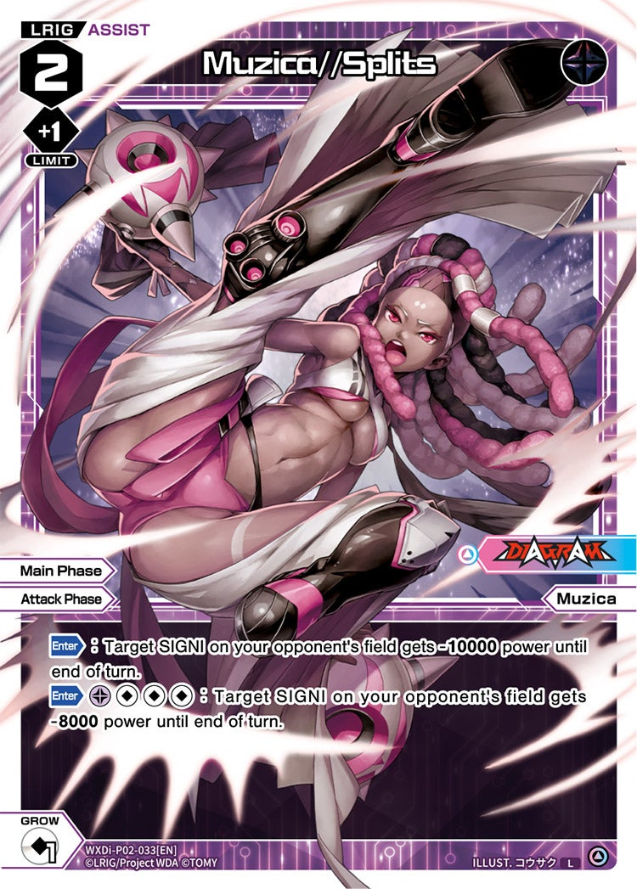

# Muzica//Splits

## Thông tin lá

| Trường | Giá trị |
| --- | --- |
| Mã in | WXDi-P02-033[EN] |
| Set | WXDi-P02[EN] |
| Số thứ tự | 033 |
| Loại thẻ | ASSIST LRIG |
| Vị trí | LRIG Deck |
| Số bản | — (set booster, không áp dụng) |
| Màu | Đen |
| Độ hiếm | L,L(P) |
| Minh họa | コウサク |
| Level | 2 |
| Limit | ＋１ |
| Power | 0 |
| LRIG type / Class | Muzica |
| Team / Master | DIAGRAM |
| Cost | — |
| Grow cost | 《C》×１ |
| Use timing | Main Phase / Attack Phase |
| Life Burst | Không |

## Card text chính thức

[Enter]: Target SIGNI on your opponent's field gets -10000 power until end of turn.
[Enter] {Black} {Colorless} {Colorless} {Colorless}: Target SIGNI on your opponent's field gets -8000 power until end of turn.

## Power text / Life Burst

—

## Ghi chú minh họa
Artist: コウサク. Ảnh L được tải từ Card List tiếng Anh.

## FAQ chính thức

**Q. Can I target the same SIGNI with two upper and lower Enter ability?**
A. Yes, you can.

## Ảnh biến thể

- [L(P)](../images/WXDi-P02-033P-EN.jpg)

## Nguồn
[Card List/FAQ chính thức](https://www.takaratomy.co.jp/products/en.wixoss/card/card.html?card_no=WXDi-P02-033%5BEN%5D ) · [Ảnh thẻ](https://www.takaratomy.co.jp/products/en.wixoss/card/thumb/WXDi-P02-033%5BEN%5D.jpg)
