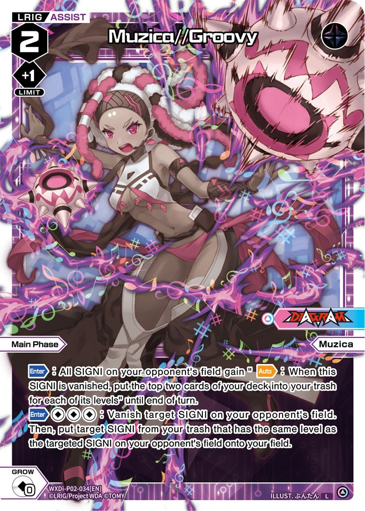

# Muzica//Groovy

## Thông tin lá

| Trường | Giá trị |
| --- | --- |
| Mã in | WXDi-P02-034[EN] |
| Set | WXDi-P02[EN] |
| Số thứ tự | 034 |
| Loại thẻ | ASSIST LRIG |
| Vị trí | LRIG Deck |
| Số bản | — (set booster, không áp dụng) |
| Màu | Đen |
| Độ hiếm | L,L(P) |
| Minh họa | ぶんたん |
| Level | 2 |
| Limit | ＋１ |
| Power | 0 |
| LRIG type / Class | Muzica |
| Team / Master | DIAGRAM |
| Cost | — |
| Grow cost | 《C》×０ |
| Use timing | Main Phase |
| Life Burst | Không |

## Card text chính thức

[Enter]: All SIGNI on your opponent's field gain "[Auto]: When this SIGNI is vanished, put the top two cards of your deck into your trash for each of its levels" until end of turn.
[Enter] {Colorless} {Colorless} {Colorless}: Vanish target SIGNI on your opponent's field. Then, put target SIGNI from your trash that has the same level as the targeted SIGNI on your opponent's field onto your field.

## Power text / Life Burst

—

## Ghi chú minh họa
Artist: ぶんたん. Ảnh L được tải từ Card List tiếng Anh.

## FAQ chính thức

**Q. If I give my opponent's SIGNI an ability with the upper Enter Ability and then vanish with the lower Enter Ability, will the Auto Ability triggered?**
A. Yes. It will  be triggered.

## Ảnh biến thể

- [L(P)](../images/WXDi-P02-034P-EN.jpg)

## Nguồn
[Card List/FAQ chính thức](https://www.takaratomy.co.jp/products/en.wixoss/card/card.html?card_no=WXDi-P02-034%5BEN%5D ) · [Ảnh thẻ](https://www.takaratomy.co.jp/products/en.wixoss/card/thumb/WXDi-P02-034%5BEN%5D.jpg)
