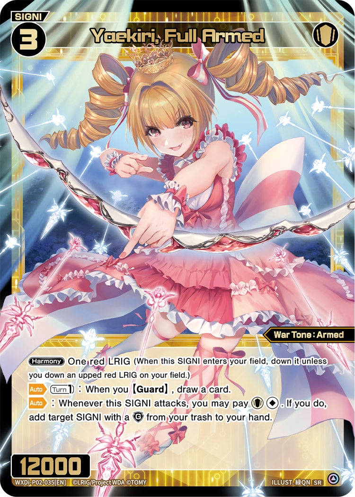

# Yaekiri, Full Armed

## Thông tin lá

| Trường | Giá trị |
| --- | --- |
| Mã in | WXDi-P02-035[EN] |
| Set | WXDi-P02[EN] |
| Số thứ tự | 035 |
| Loại thẻ | SIGNI |
| Vị trí | Main Deck |
| Số bản | — (set booster, không áp dụng) |
| Màu | Trắng |
| Độ hiếm | SR |
| Minh họa | 緑QN |
| Level | 3 |
| Limit | — |
| Power | 12000 |
| LRIG type / Class | War Tone：Armed |
| Team / Master | — |
| Cost | — |
| Grow cost | — |
| Use timing | — |
| Life Burst | Không |

## Card text chính thức

[Harmony] One red LRIG (When this SIGNI enters your field, down it unless you down an upped red LRIG on your field.)
[Auto] {1/Turn}: When you 【Guard】, draw a card.
[Auto]: Whenever this SIGNI attacks, you may pay {White} {Colorless}. If you do, add target SIGNI with a {Guard Icon} from your trash to your hand.

## Power text / Life Burst

—

## Ghi chú minh họa
Artist: 緑QN. Ảnh SR được tải từ Card List tiếng Anh.

## FAQ chính thức

**Q. When Auto Ability triggered, if a card paid as Ener Cost is a SIGNI with "Guard Icon", can I add it to my hand as a target?**
A. No, you can't, because the timing of Target is prior to the payment of the Ener cost.

## Nguồn
[Card List/FAQ chính thức](https://www.takaratomy.co.jp/products/en.wixoss/card/card.html?card_no=WXDi-P02-035%5BEN%5D ) · [Ảnh thẻ](https://www.takaratomy.co.jp/products/en.wixoss/card/thumb/WXDi-P02-035%5BEN%5D.jpg)
