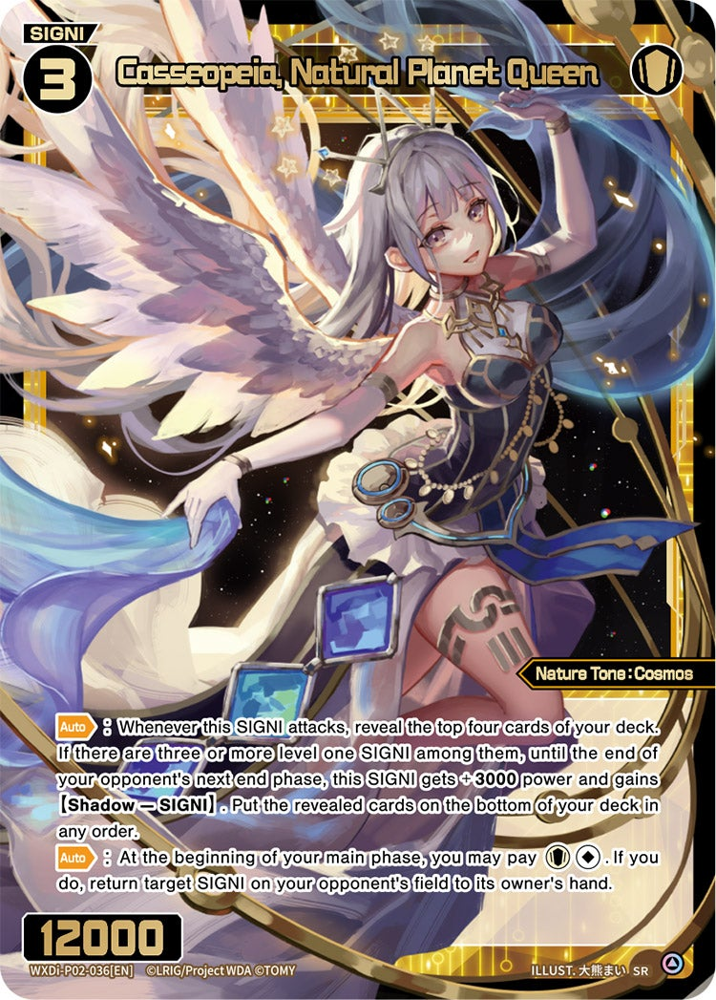

# Casseopeia, Natural Planet Queen

## Thông tin lá

| Trường | Giá trị |
| --- | --- |
| Mã in | WXDi-P02-036[EN] |
| Set | WXDi-P02[EN] |
| Số thứ tự | 036 |
| Loại thẻ | SIGNI |
| Vị trí | Main Deck |
| Số bản | — (set booster, không áp dụng) |
| Màu | Trắng |
| Độ hiếm | SR |
| Minh họa | 大熊まい |
| Level | 3 |
| Limit | — |
| Power | 12000 |
| LRIG type / Class | Nature Tone：Cosmos |
| Team / Master | — |
| Cost | — |
| Grow cost | — |
| Use timing | — |
| Life Burst | Không |

## Card text chính thức

[Auto]: Whenever this SIGNI attacks, reveal the top four cards of your deck. If there are three or more level one SIGNI among them, until the end of your opponent's next end phase, this SIGNI gets +3000 power and gains 【Shadow — SIGNI】. Put the revealed cards on the bottom of your deck in any order.
[Auto]: At the beginning of your main phase, you may pay {White} {Colorless}. If you do, return target SIGNI on your opponent's field to its owner's hand.

## Power text / Life Burst

—

## Ghi chú minh họa
Artist: 大熊まい. Ảnh SR được tải từ Card List tiếng Anh.

## FAQ chính thức

— (không có FAQ riêng cho mã này trên trang FAQ tiếng Anh.)

## Nguồn
[Card List/FAQ chính thức](https://www.takaratomy.co.jp/products/en.wixoss/card/card.html?card_no=WXDi-P02-036%5BEN%5D ) · [Ảnh thẻ](https://www.takaratomy.co.jp/products/en.wixoss/card/thumb/WXDi-P02-036%5BEN%5D.jpg)
